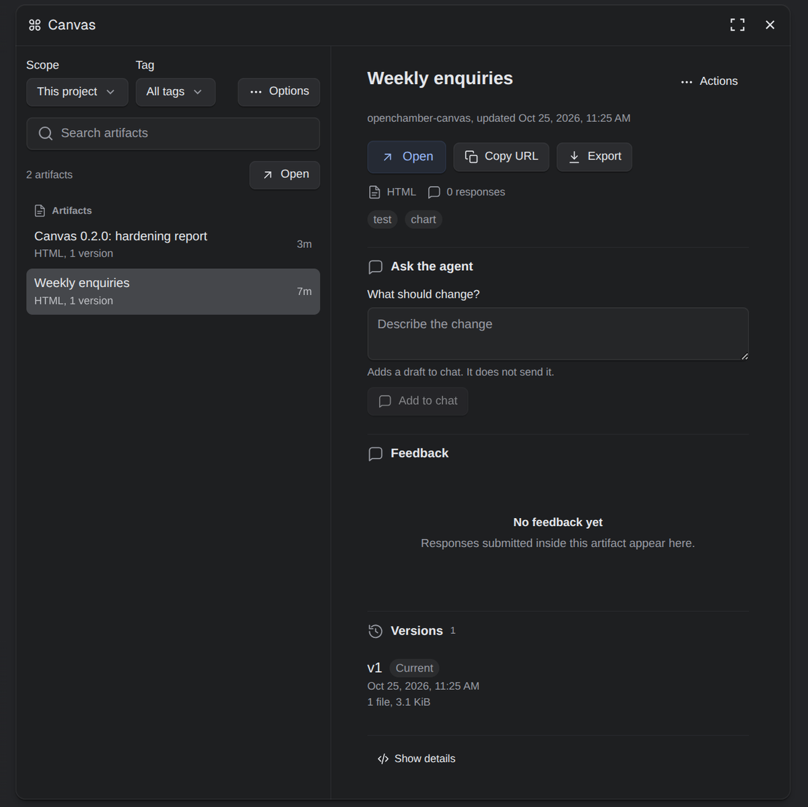
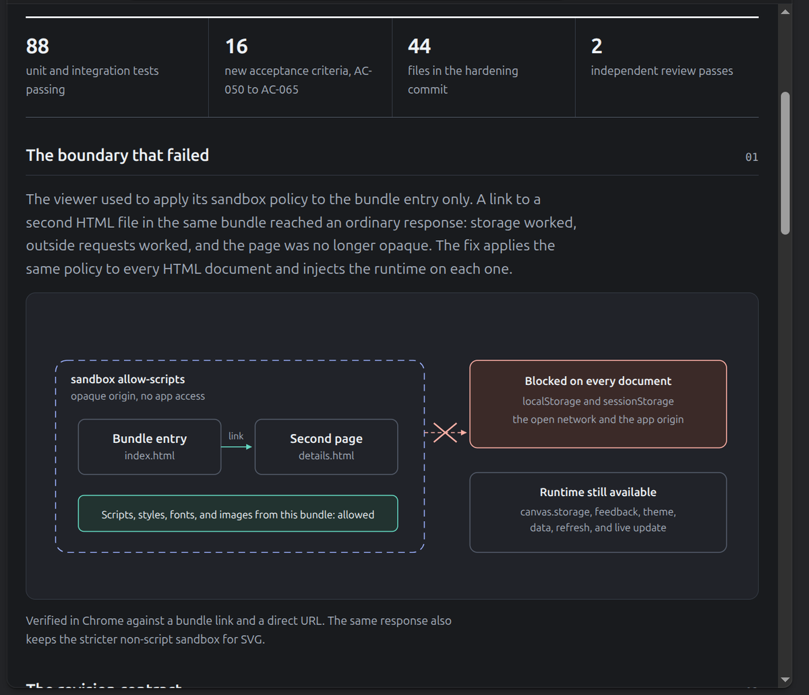
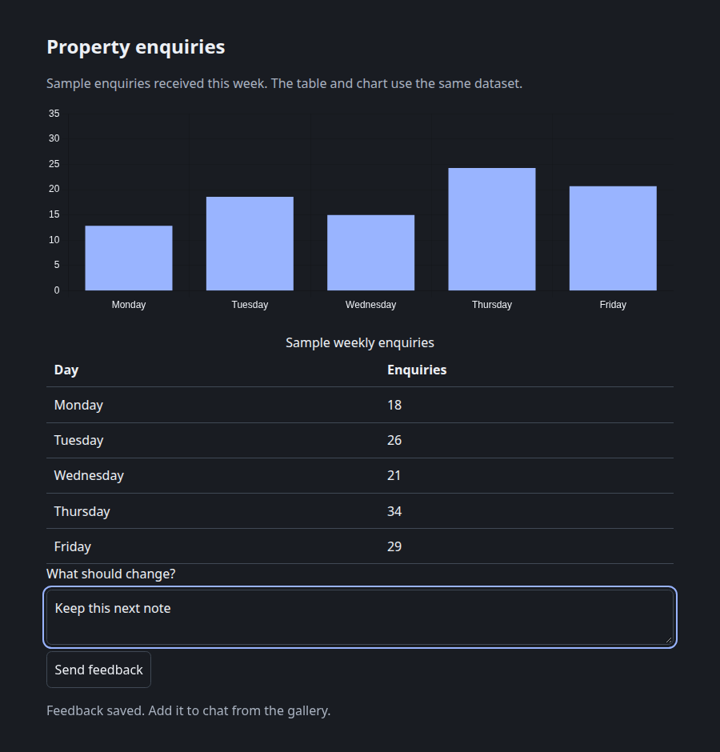
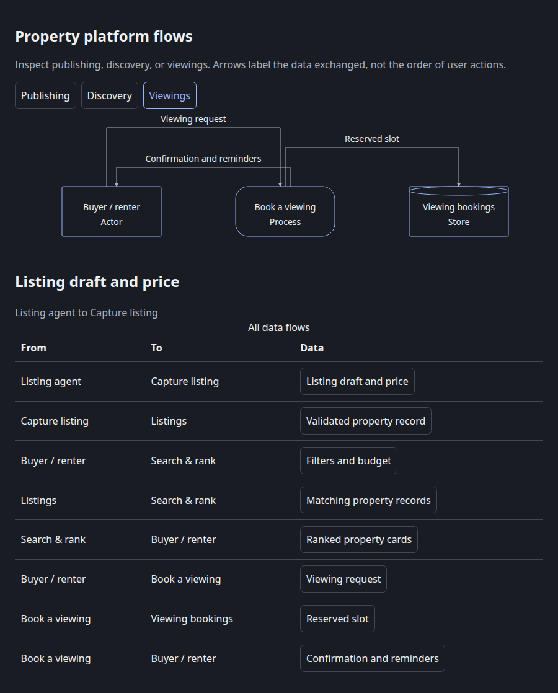
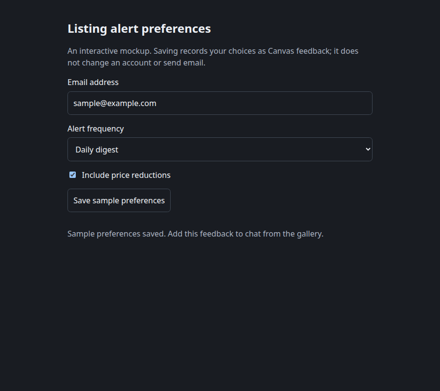

# OpenChamber Canvas

A persistent project gallery for the charts, diagrams, reports, and interface mockups your agent creates. Each artifact is a versioned object instead of a chat card: reopen it, compare versions, ask for changes, and keep the work.



Canvas is an OpenChamber extension with a native OpenCode plugin. The extension provides the gallery and the local viewer. The plugin lets the agent publish, read, and update artifacts. No separate MCP server is needed.

## What you get

- **Artifacts that outlive the chat.** Everything is stored under `~/.config/openchamber/artifacts` and grouped by project.
- **Versions, not overwrites.** Open a saved version as a fixed snapshot, or follow the current one as the agent revises it. Restore any retained version.
- **Feedback with a clear handoff.** Select responses written inside an artifact, add them to the chat composer, review them, then send.
- **Drafts that stay put.** A revision note follows its artifact while you move around the gallery, change scope, open Setup, or wait for a response.
- **Local rendering.** Artifacts run in OpenChamber's browser panel under a sandboxed viewer on loopback. The app origin and the open network stay out of reach.
- **Pinned dependencies.** New versions record their runtime and library bytes. Chart.js, D3, and Mermaid are bundled locally, not loaded from a CDN.
- **Search that covers the store.** Search, tags, archive state, and sort run before pagination, so an older artifact does not disappear behind the latest page.

## See it

The gallery lists artifacts for the current project and opens the selected one in the browser panel. The inspector shown above carries Open, Copy URL, and Export, followed by the revision field, feedback, versions, and technical details.

Here is the 0.2.0 hardening report as an artifact, including the sandbox boundary that changed:



### Example artifacts

The repository includes source examples you can publish or copy: a chart, a focused data-flow diagram, and an interactive preferences mockup. The diagram derives its focused views, complete flow table, and selection details from one graph definition.

| Chart | Diagram | Interface mockup |
|:--:|:--:|:--:|
|  |  |  |

The examples live in [`examples/`](examples/README.md) with publishing notes. They have no external requests and work in light and dark themes.

## Install

Requirements: OpenChamber 2.5.1 or newer, OpenCode 2.2.0 or newer, and Node 24 on the machine that runs OpenChamber.

1. Open **Settings → Extensions → Add**.
2. Paste the Git URL: `https://github.com/P4rthPat3l/openchamber-canvas`.
3. Approve the `service` permission.
4. Open **Canvas** on the right rail, then **Canvas → Setup**.
5. Copy the plugin configuration from Setup. Merge its entry into the `plugins` array in your user `~/.config/opencode/opencode.json` or project `opencode.json`. Keep your existing settings and plugin entries:

   ```json
   {
     "$schema": "https://opencode.ai/config.json",
     "plugins": ["/absolute/path/to/installed/canvas"]
   }
   ```

   Setup fills in this installation's exact package directory, not a JavaScript filename. OpenCode loads the built plugin from that package. Configuration changes reload automatically; use `/reload` if needed.
6. Use **Add sample prompt to chat**, review the prompt, and send it to test the tools.

The gallery works without the OpenCode plugin: you can browse, open, export, and copy artifacts. The agent cannot publish or revise until the plugin is loaded. The extension does not change your OpenCode configuration, and the gallery does not guess whether a session has loaded its tools.

## Use it

**Publish.** Ask the agent for a chart, dashboard, diagram, report, or interface mockup. It calls the Canvas tools and opens the result. Use `openchamber_render` for a page that belongs in the chat reply; use Canvas when you need to reopen, version, or iterate on the work.

**Revise.** In the inspector, write what should change. Canvas adds a draft to the chat composer; it does not send it. Review the message and send it. The agent reads the artifact before updating it.

**Give feedback.** Artifacts can call `window.canvas.feedback(...)` from a form or a button. Responses appear in the inspector with their version and state. Select the ones you want, choose **Add feedback to chat**, and review the composed message.

**Compare versions.** Opening an artifact without a version follows updates. Opening a specific version stays fixed. **Show older versions** expands the retained history; **Restore** copies an older version into a new one.

**Organize.** Switch between This project, All projects, Archived, and Trash. Search by title, project, or tag. Use favorites, list or grid, and the Options menu for refresh, setup, and sorting.

## How it works

Four parts share one store:

- An **extension panel** lists artifacts and opens them.
- An **extension service** reads the store, mints view URLs, and handles export and feedback.
- A detached **viewer daemon** serves artifact HTML, the runtime API, pinned libraries, and live updates over loopback.
- A **native OpenCode plugin** registers `publish`, `update`, `list`, `read`, `archive`, and `result` under the `canvas` namespace. Effective tool names are `canvas_publish`, `canvas_update`, and so on. OpenCode can expose them through Code Mode as `tools.canvas.publish` and related calls.

The extension asks for the `service` permission only. The user separately authorizes the OpenCode plugin through their plugin configuration. Tools use OpenCode's permission system and take project/session context from the invoking session.

The viewer outlives a plugin reload, so an open artifact does not depend on the agent session staying alive. The browser panel renders the page; the viewer enforces the sandbox. Native annotation does not reach these sandboxed pages, so feedback and revision notes are the supported review path.

More detail: [feature document](docs/features/FEAT-001-openchamber-canvas.md), [platform research](docs/research/openchamber-extension-platform.md), and [gallery design](docs/design/canvas-gallery.md).

## Development

```bash
bun install
bun run typecheck
bun run lint
bun test
bun run test:browser
bun run build
```

- `bun test` covers operations, native registration, relocated packages without node_modules, store/viewer security, and service contracts. When `opencode` is on PATH, it also loads the package in an isolated real OpenCode server without a model request. That check is explicitly skipped when the CLI is absent.
- `bun run test:browser` builds the distribution, tests the real panel and status entries in an opaque mock host, launches the bundled native plugin and Node viewer/runtime, and checks the examples in light and dark themes. It needs Chrome at `/usr/bin/google-chrome`.
- `bun run build` writes the committed distribution files, including `viewer/build.json`, which pins the viewer/runtime/library build identity.
- Browser test stores and screenshots stay under `/tmp/opencode`.

Installed-app acceptance for the desktop shell, host routing, and the chat tool card remains a manual check. The automated browser suite uses a mock host and the bundled viewer, not the installed desktop UI.

## Requirements and limits

- OpenChamber desktop or web, tested against 2.5.1. Extensions do not load in VS Code or on mobile.
- Local machine only. A remote client cannot reach the server's loopback viewer; use Copy URL or Export there.
- Artifact HTML is model output. Treat it as untrusted; the viewer sandboxes it.
- Exports contain authored source files. The viewer runtime and pinned libraries are not bundled into a standalone export.
- The store is local and has no cloud sync, public links, or collaboration.
- No analytics or telemetry.

## License

MIT
