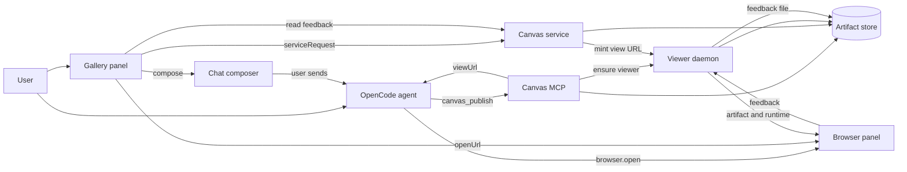
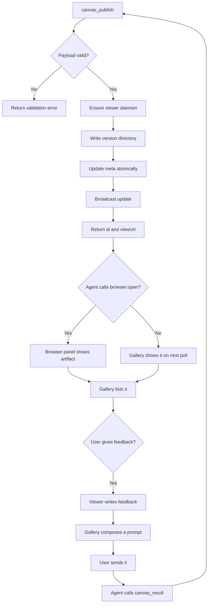
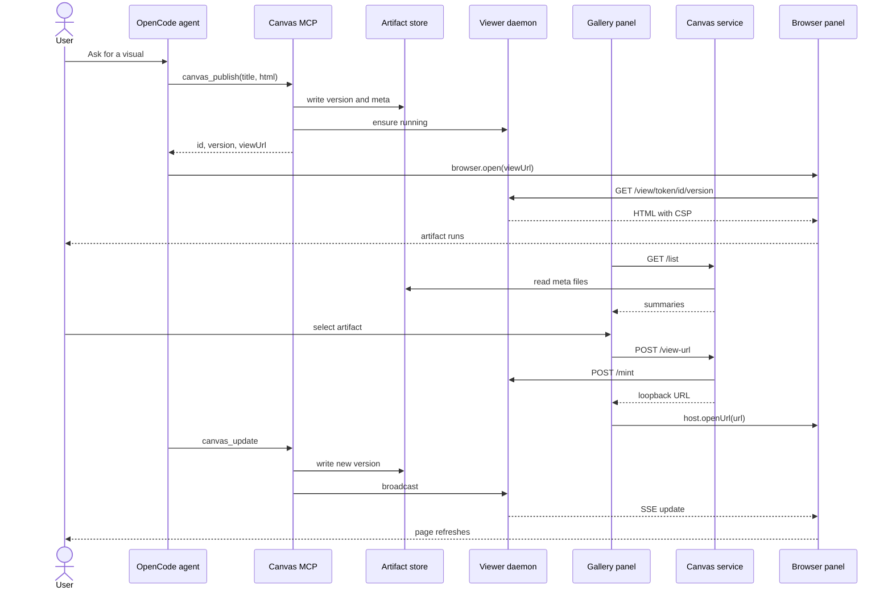
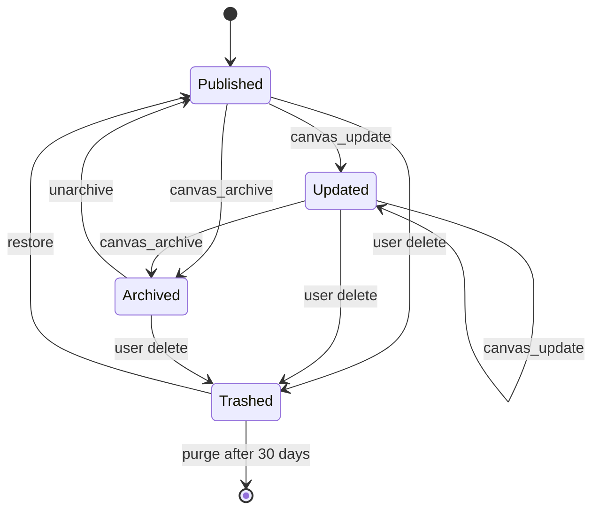
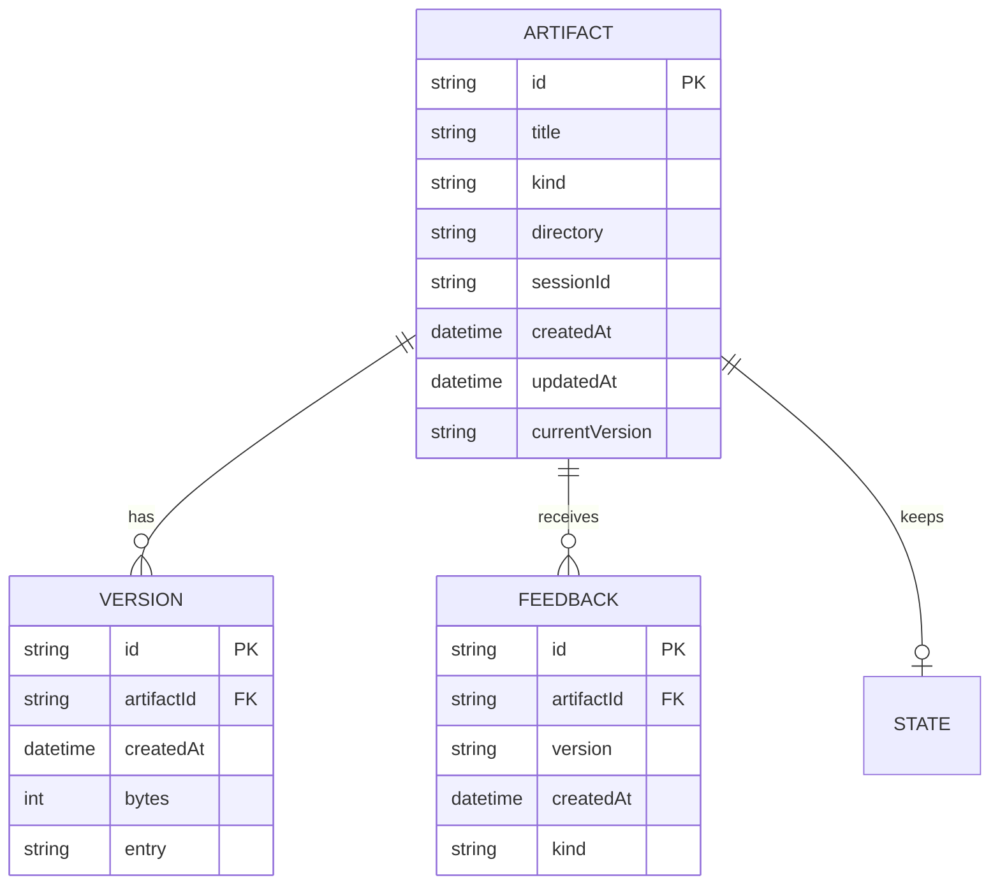
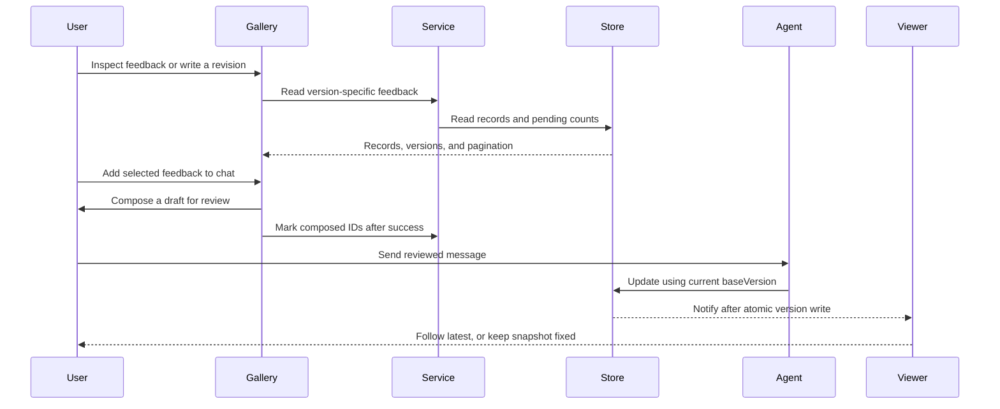

# OpenChamber Canvas

> A project gallery for agent-generated artifacts that opens each one in OpenChamber's browser panel, keeps its versions, refreshes it in place, and carries user feedback back to the agent.

The [security and revision hardening](#37-security-and-revision-hardening) is built in package 0.2.0. AC-050 through AC-065 define its behavior. Verification covers the uncommitted working tree, not a new Git commit; installed-app acceptance is pending.

## 1. Feature Snapshot

| Field | Details |
|---|---|
| Document status | Active |
| Implementation status | 0.2.0 security and revision hardening built; installed acceptance pending |
| Owner | Parth |
| Primary actors | User, OpenCode agent, gallery extension, extension service, viewer daemon, MCP server, browser panel |
| Trigger | The agent publishes or updates an artifact, or the user opens the gallery |
| Outcome | The artifact is stored, versioned, opened in the browser panel, and kept current |
| Entry points | Rail panel, full-screen page, Work Status section, chat tool card, MCP tools `canvas_*` |
| Data stores | `~/.config/openchamber/artifacts` on the machine that runs OpenChamber |
| External systems | OpenChamber extension host, OpenChamber browser panel, OpenCode MCP client |
| Feature flag | None in v1 |
| Last verified | 88 unit/integration tests pass. Typecheck and lint pass. The browser command passes against the actual gallery/status entries, bundled Node viewer/runtime/MCP, and light/dark authoring examples. It covers document isolation, fixed/following views, feedback handoff, drafts, search, and setup. The design detector reports no findings. Independent reviews received fixes and regression tests. Installed-app acceptance is pending. |

### At a Glance

`openchamber_render` draws a page inside a chat message. It is bounded by the message width, scrolls away, keeps no history, and cannot receive a structured answer beyond `awaitAnswer`. This feature moves visual output into a gallery and a browser view that persist.

The agent publishes through an MCP tool. A local viewer daemon serves the stored files on loopback. The gallery lists artifacts by project, opens the selected one in OpenChamber's browser panel, and shows new versions and user feedback.

The feature is built from four parts:

- An extension panel that lists artifacts and opens them.
- An extension service that reads the store and proxies viewer requests.
- A detached viewer daemon that serves artifact files and runtime APIs.
- A standalone MCP server that writes the store and gives the agent tools.

Both the MCP and the service use the same viewer daemon and the same on-disk store. No OpenChamber core change is required.

The store, view policy, viewer server, runtime, pinned library set, MCP server, extension service, and gallery panel exist. The SDK UI migration is built; installed acceptance is pending.

### Design direction

The gallery is a native OpenChamber extension surface built from the public `@openchamber/sdk/ui` controls, not a separate visual brand or a copied set of app React components. The app supplies colors, fonts, radii, shadows, focus treatment, and selection states through `applyHostReady`; the SDK supplies buttons, fields, search, selects, menus, lists, badges, banners, empty states, spinners, and separators.

Custom CSS owns only composition the installed kit cannot provide: the responsive list/inspector split, flat grid tiles, version metadata rows, setup/status layout, and the native confirmation dialog frame. Interactive children in those areas remain SDK controls. The rail and page use the same controls; the page keeps the shelf beside the inspector, while the rail replaces the shelf with the inspector and a Back control. View/sort preferences use `host.storage`.

See [PRODUCT.md](../../PRODUCT.md) for product truth and [canvas-gallery.md](../design/canvas-gallery.md) for the surface rules.

### What changed from 0.1

The first draft had a workable shape but several problems that would have surfaced during implementation:

- Two viewers served HTML with two CSP implementations. The MCP process is also freed when a project idles out, so its view URLs would expire. 0.2 introduces one viewer daemon.
- The CSP blocked all network, including the runtime that provides feedback, storage, and live refresh. 0.2 allows exactly the viewer origin.
- The 0.1 tool names already carried a `canvas_` prefix. A server named `canvas` would have produced `canvas_canvas_publish`. 0.2 names the server `canvas` and the tools `publish`, `update`, `list`, `read`, `archive`, `result`.
- The plan only stored one HTML string. 0.2 adds artifact kinds and bundles, and keeps the storage model open enough for Markdown, images, PDF, and data snapshots.
- Publishing was one-way. 0.2 adds a feedback channel from the artifact to the agent.
- An open artifact did not update. 0.2 adds in-place refresh.
- `canvas_delete` let the agent delete user data. 0.2 lets the agent archive, and the user deletes.
- `current.html` duplicated the current version. 0.2 resolves the current pointer and serves the version file.
- `canvas_publish` returned the absolute store path. 0.2 returns an id and a view URL.
- The gallery had no search, tags, favorites, export, restore, or session provenance. 0.2 includes them.
- The extension permission list stays at `service` only. Refine and feedback use `host.compose`, so the user reviews the message before it is sent.
- The update contract was underspecified. 0.2 defines full replacement, file snapshot, partial bundle merge, exact edits, and restore.

### Status Legend

Every `Status` value in this document is one of `Current`, `Planned`, `Inferred`, or `Unknown`. This document has no `Current` claims because `last_verified_commit` is null.

Platform behavior was checked by reading the installed OpenChamber 2.5.1 build at `/opt/OpenChamber` and `@openchamber/sdk@2.5.1` on 2026-10-23. That evidence is stated in prose, not as a `Current` claim about this repository. The platform reference is [openchamber-extension-platform.md](../research/openchamber-extension-platform.md).

## 2. Problem and Outcome

### Problem

Agent-generated visual work is trapped in the transcript. A page in a chat message inherits the message width, disappears when the user scrolls, has no version history, and cannot be reopened later. There is no place to see artifacts grouped by project. There is no way for an artifact to send a structured answer back to the agent. There is no way for an open artifact to update when the agent revises it.

The browser panel already solves rendering, JavaScript, annotation, DevTools, and capture. Nothing connects artifacts to it.

### Desired Outcome

The user asks an agent for a chart, dashboard, diagram, report, or HTML mockup. The agent calls one tool. The artifact is stored, the browser panel opens it, and the gallery shows it in the right rail under the project it belongs to. When the agent updates it, the open page refreshes in place. When the user fills a form or picks an option in the artifact, the gallery can put that answer in the chat box for the user to send.

The user can reopen any previous artifact, switch between "This project" and "All projects", inspect versions, restore an older one, export a copy, and attach it to a session.

### Success Measures

| Measure | Target | How measured |
|---|---|---|
| Publish and open | An agent publish reaches the browser panel in one turn | Phase 6 acceptance run |
| Persistence | Every stored artifact can be reopened after an app restart | AC-006 |
| Live update | An open page shows a new version without a manual reload | AC-015 |
| Feedback | A form result in an artifact reaches the agent in one call | AC-017 |
| Organization | Current project is the default filter and all projects are one click away | AC-002 and AC-003 |
| Isolation | Artifact code cannot reach the OpenChamber API or the open network | SEC-001, SEC-011, AC-007 |
| Kinds | HTML and bundles work in v1; Markdown, image, and PDF work in v1.1 | AC-018 to AC-021 |
| Install | A new user can install the extension and MCP server from the setup page | Manual acceptance |

No analytics are added. Success is measured by the acceptance run and local logs.

## 3. Scope

### Included

- Publishing artifacts from an agent through MCP.
- Artifact kinds: single-file HTML in v1; bundles in v1; Markdown, image, and PDF in v1.1.
- Version history for one artifact, including restore and compare.
- A project filter and an all-projects view.
- Opening artifacts in OpenChamber's browser panel through a loopback URL.
- Live refresh when the agent updates an open artifact.
- A feedback channel from the artifact to the agent.
- A bundled library set so artifacts work without a CDN.
- Search, tags, favorites, and archive.
- Export to a file on disk.
- Session provenance.
- A chat tool card for `canvas_*` calls.
- A Work Status section with the latest artifact and a feedback count.
- Deleting artifacts from the gallery, with a trash folder.
- Empty, loading, error, and remote-instance states.

### Excluded

- Changing OpenChamber core or adding a built-in canvas surface.
- Mobile and VS Code. Extensions do not load there.
- Remote instances where the browser panel and the viewer daemon are on different machines. V1 warns and offers export.
- Cloud publishing, public links, and remixing by other users.
- Collaborative editing or comments inside the artifact.
- A WYSIWYG editor. The agent remains the editor.
- Rendering artifacts inside the gallery panel. Only the browser panel executes artifact code.
- Rendering arbitrary HTML in a chat card. `contributes.tools` is presentation only.
- Direct artifact execution with `eval` or `innerHTML` in the extension page.
- Live streaming of the artifact while the agent writes. Publishing is atomic.
- A command-based live data source in v1. V1.1 starts with files.

### Assumptions

| ID | Assumption | Confidence | Validation needed |
|---|---|---|---|
| ASM-001 | `host.openUrl` on a loopback URL opens the browser panel when a project or chat is open | High | Probe P1 |
| ASM-002 | The gallery panel stays mounted while the browser panel is shown | Medium | Probe P3 |
| ASM-003 | A local stdio MCP server starts with the project directory as its working directory | Medium | Probe P9 |
| ASM-004 | The browser panel loads a loopback page under a sandbox CSP with inline JavaScript running | High | Probe P4 |
| ASM-005 | `browser.open` raises the browser panel when the agent web tool is enabled | Medium | Probe P5 |
| ASM-006 | The extension service can read and serve files from the artifact store | High | Phase 4 integration test |
| ASM-007 | The desktop app and the viewer daemon run on the same machine | High | Constraint |
| ASM-008 | A detached viewer daemon survives an MCP restart and keeps a view URL alive | Medium | Probe P6 |
| ASM-009 | A sandboxed view page can call the viewer daemon with `fetch` and `EventSource` under CORS `Origin: null` | Medium | Probe P8 |
| ASM-010 | `localStorage` throws in the sandboxed view, so a runtime storage shim is needed | High | Probe P7 |
| ASM-011 | OpenCode reports a server named `canvas` with a tool named `publish` as `canvas_publish` | High | Probe P9 |
| ASM-012 | A project that idles frees its MCP servers after about 15 minutes | High | Probe P10 and changelog 2.5.1 |
| ASM-013 | The gallery can detect a remote instance from a non-loopback `location.hostname` | Medium | Probe P11 |
| ASM-014 | Browser panel annotation works on a loopback page | Medium | Probe P5 |
| ASM-015 | The panel can receive a base64 thumbnail from `serviceRequest` and show it as a blob URL | High | Phase 4 test |

Probe results on 2026-10-23:

- ASM-001, ASM-002, ASM-003, ASM-004, ASM-008, ASM-009, ASM-010, and ASM-011 pass.
- ASM-005 and ASM-014 are pending the annotation and agent browser checks.
- ASM-006, ASM-007, ASM-012, ASM-013, and ASM-015 are pending later phases.

## 4. Terminology

| Term | Meaning |
|---|---|
| Artifact | One stored item with a title, a project, a kind, and a version history |
| Canvas | The feature as a whole. The name is used in the extension id, MCP server, and tool names |
| Gallery | The extension panel that lists artifacts and opens them |
| Store | The directory tree at `~/.config/openchamber/artifacts` |
| Viewer daemon | The detached process `canvasd` that serves artifact files, runtime APIs, and live updates |
| View URL | A loopback HTTP URL that serves one artifact version with a sandbox policy |
| Publisher | The MCP server that writes artifacts |
| Service | The extension-owned host process that reads the store and proxies viewer requests |
| Bundle | A version made of several files with an entry HTML file |
| Runtime | The injected `canvas.js` script that gives an artifact storage, feedback, live data, and refresh |
| Library set | The pinned, vendored JavaScript libraries the viewer serves to artifacts |
| Feedback | A JSON payload an artifact sends to the viewer for the agent to read |
| Live source | A file or, later, a command that an artifact reads when it opens |
| Tool card | The chat presentation of a `canvas_*` call, declared in `contributes.tools` |
| Browser panel | OpenChamber's built-in browser beside the chat |

## 5. Actors and Permissions

| Actor | Allowed actions | Restrictions | Enforcement point |
|---|---|---|---|
| User | Publish through the agent, browse, filter, open, annotate, export, archive, delete | Delete asks for confirmation and moves to trash | Gallery UI |
| Agent | Call `canvas_publish`, `canvas_update`, `canvas_list`, `canvas_read`, `canvas_archive`, `canvas_result`, open the returned URL | Cannot delete, cannot choose the viewer port or token | MCP tool schemas |
| Gallery extension | Read summaries through the service, ask for a view URL, call `openUrl`, `compose`, `attach` | No direct artifact execution, no filesystem capability | Extension host and service |
| Service | Read the store, mint view URLs, read feedback, write exports | Loopback only, service token required, path allowlist | Service routes |
| Viewer daemon | Serve one version per request, stream updates, write feedback and state | Loopback only, per-artifact tokens, store root only | Daemon routes |
| MCP server | Write, update, list, read, archive artifacts | Store root only, size caps, no shell | MCP handlers |
| Browser panel | Render the artifact | Opaque origin, no open network, no app access | Response CSP |

The extension asks for one permission, `service`, which the user approves once at install and which runs with the user's full access. The gallery uses `host.compose` to put a feedback summary or a refine instruction in the chat box; the user reviews and sends it. `prompt` and `sessions` are not requested in v1. One-click send and opening another session are v1.1 options.

`service` is the only permission that runs code outside the sandbox. The approval dialog says so.

## 6. User Journey

### Primary Journey

1. The user asks the agent for a visual artifact inside a project session.
2. The agent calls `canvas_publish` with a title, a kind, and self-contained HTML.
3. The MCP validates the payload, ensures the viewer daemon is running, writes a version, and returns an id plus a view URL.
4. The agent calls `openchamber_web` with `browser.open` on the view URL.
5. The browser panel opens the artifact with JavaScript running.
6. The gallery service lists the new artifact under the current project.
7. The user later opens the gallery, switches to "All projects", and reopens an older artifact.

### Alternate Journeys

| Journey | Trigger | Expected outcome |
|---|---|---|
| Iterate | The agent calls `canvas_update` on the same id | A new version is stored, the open page refreshes, and the gallery shows the new count |
| Read before edit | The agent calls `canvas_read` | The current source comes back, so the agent can make a targeted change |
| Feedback | The user submits a form or picks an option in the artifact | The viewer writes a feedback record; the gallery shows a badge and composes a prompt with the feedback id; the user sends it |
| Refine | The user clicks "Refine with agent" and types an instruction | The gallery calls `host.compose({ text, mode: "append" })` with the artifact id and instruction; the user reviews and sends it |
| Restore | The user picks an older version and clicks Restore | A new version is created from the old content; history is preserved |
| Export | The user clicks Export | A copy is written to the export folder and the path is shown |
| Attach | The user clicks Attach to chat | An artifact chip is placed on the composer |
| No agent web tool | The agent cannot call `browser.open` | The artifact is stored and the gallery shows it with an Open action |
| Gallery closed | The user closed the rail panel | The agent still opens the artifact; the gallery catches up when reopened |
| No project | A session without a registered project publishes | The artifact is stored as Uncategorized and appears under All projects |
| Remote instance | The client is connected to another machine | The gallery explains that loopback viewing is unavailable and offers Copy URL and Export |
| Delete | The user deletes an artifact | The directory moves to trash, the gallery hides it, and an open tab shows a not-found page on reload |
| Archive | The agent archives an artifact | It leaves the default list and remains restorable |

## 7. System Context



The agent and the gallery reach the same store through separate processes. The MCP writes. The service reads and proxies. The viewer daemon serves HTML and runtime APIs. The browser panel renders.

### Platform Facts

These behaviors were checked by reading the installed build and the SDK package. They are not claims about code in this repository.

- The guest API exposes `host.openUrl(url)` and accepts only http and https.
- A URL on `localhost`, `127.0.0.1`, `0.0.0.0`, or `::1` opens in the browser panel when the panel is available and a project or chat is open. Other URLs go to the system browser.
- No capability is required for `openUrl`.
- Guest pages are served with a content security policy that begins `sandbox allow-scripts` and allows inline scripts.
- Guest frames use `sandbox="allow-scripts"` and cannot reach the app origin.
- An extension service binds `127.0.0.1` on a host-assigned port and receives `OPENCHAMBER_SERVICE_PORT` and `OPENCHAMBER_SERVICE_TOKEN`.
- The host polls `GET /health` with the bearer token and marks the service ready within 15 seconds.
- The service starts on the first `serviceRequest`, not at install.
- Extension pages run in the web and desktop apps, not in VS Code or mobile.
- Local MCP servers are configured in Settings, MCP with a command, arguments, and environment.
- OpenCode prefixes MCP tool names with the server name.
- A project that is left alone frees its MCP servers after about 15 minutes.
- The browser panel annotation tools are desktop-only.
- The browser panel can read the clipboard only on the literal `localhost` hostname, not on `127.0.0.1` or `[::1]`.
- `contributes.tools` changes how a tool call is drawn. It does not add a tool.
- An extension cannot register an MCP server or an agent tool.

The full reference is [openchamber-extension-platform.md](../research/openchamber-extension-platform.md).

## 8. Control Flow



| Step | Status | Controlling component | Decision or action | Failure behavior |
|---|---|---|---|---|
| Validate | Planned | MCP handler | Check kind, size, title, paths, external references | Return `INVALID_ARTIFACT`, write nothing |
| Ensure viewer | Planned | MCP handler | Read the port file, health check, or spawn | Return no `viewUrl`, keep the artifact |
| Write | Planned | Store | Temp directory, fsync, rename, update meta | Leave the previous version intact |
| Broadcast | Planned | Viewer daemon | SSE message to open viewers | The next open shows the new version |
| Open | Planned | Agent or gallery | `browser.open` or `host.openUrl` | The user can open from the gallery |
| List | Planned | Service | Read meta files, sort by `updatedAt` | Return a partial list with an error count |
| Feedback | Planned | Viewer daemon | Append a feedback record | The artifact shows a retry |
| Deliver | Planned | Gallery | `host.compose` with the feedback id | The record stays pending |

## 9. Data Flow



### Data Transformations

| Stage | Status | Input | Transformation | Output |
|---|---|---|---|---|
| MCP | Planned | Title, kind, HTML, files, directory | Trim, cap, slug, validate, hash | Artifact id and version id |
| Store | Planned | HTML or files | UTF-8 write to a temp directory, rename | `versions/<version>/` |
| Viewer | Planned | Version manifest | Resolve entry, inject runtime, build CSP | Sandboxed HTML response |
| Runtime | Planned | View token | Expose storage, feedback, live data, refresh | `window.canvas` |
| Service | Planned | Meta files | Parse, sort, filter, map project | Summary list |
| Gallery | Planned | Summaries | Group, search, sort, format dates | Rendered list |

### Sensitive Data

| Data | Classification | Storage | Logging rule | Retention |
|---|---|---|---|---|
| Artifact HTML and files | User content, untrusted | Store on disk | Never log bodies | Until deleted |
| Project directory | Internal | `meta.json` | Log only on error, at most the basename | Until deleted |
| Service token | Secret | Process memory | Never log | Process lifetime |
| Viewer secret | Secret | Port file, 0600 | Never log | Daemon lifetime |
| View token | Secret | URL path and daemon memory | Never log the full URL | 24 hours or daemon restart |
| Feedback payload | User content, untrusted | Feedback file | Never log bodies | Until deleted or 30 days |
| Runtime state | User content | `state.json` | Never log bodies | Until artifact deletion |

## 10. State Model

### Artifact



An artifact is published once and updated in place. Each update appends an immutable version and moves the current pointer. Archive hides it from the default list. Delete moves it to trash for 30 days. The agent cannot delete.

### Version

| State | Meaning | Allowed transitions | Side effects |
|---|---|---|---|
| Current | The version the viewer opens by default | Superseded, Pinned | Appears first in the version list |
| Superseded | An older version, still readable | Restored, Pinned | Kept until pruning |
| Pinned | A version exempt from pruning | Unpinned | Shown with a pin |
| Restored | A new version copied from an older one | Current | `restoredFrom` records the source |

### Feedback

| State | Meaning | Allowed transitions | Side effects |
|---|---|---|---|
| Pending | Written by the artifact, not yet added to chat | Added to chat | Counts toward the pending badge |
| Added to chat | The gallery successfully composed selected feedback, then recorded `deliveredAt` | May be deliberately added again | Does not mean sent or read; `canvas_result` does not change this state |

## 11. Implementation Map

### Existing Artifacts

Phases 1 to 5, 2026-10-23:

| Path | What it does | Verification |
|---|---|---|
| `package.json`, `tsconfig.json`, `scripts/build.ts` | Bun workspace, strict TypeScript, build entries, library copy | `bun run typecheck`, `bun run build` |
| `src/store/errors.ts` | Store error codes and `StoreError` | `tsc` |
| `src/store/types.ts` | Artifact, version, update, feedback, state, and list types | `tsc` |
| `src/store/id.ts` | ULID artifact ids, sortable version ids, slugs | `tests/store.test.ts` |
| `src/store/paths.ts` | Safe ids, versions, relative paths, store roots, realpath checks | `tests/store.test.ts`, `tests/policy.test.ts` |
| `src/store/schema.ts` | Meta, version manifest, feedback, and state validation | `tests/store.test.ts`, `tests/feedback.test.ts` |
| `src/store/fs.ts` | Durable writes, atomic JSON, MIME map, hashes | `tests/store.test.ts` |
| `src/store/lock.ts` | Directory lock with stale recovery | `tests/store.test.ts` |
| `src/store/index.ts` | Create, four update modes, restore, read, list, archive, favorite, pin, trash, prune, feedback, state | `tests/store.test.ts`, `tests/feedback.test.ts` |
| `src/viewer/policy.ts` | CSP, CORS, per-artifact view tokens, safe file resolution | `tests/policy.test.ts` |
| `src/viewer/server.ts` | `/health`, `/mint`, `/notify`, `/view`, `/events`, `/api`, `/libraries`, port file, idle exit | `tests/viewer.test.ts` |
| `src/viewer/runtime/canvas.ts` | `window.canvas` storage, feedback, data, refresh, theme, live update | Browser e2e |
| `src/viewer/ensure.ts` | Detached spawn, port file discovery, mint, notify | `tsc`, built-viewer e2e |
| `src/mcp/source.ts` | `filePath` and `directoryPath` readers, external-reference scan | `tests/mcp.test.ts` |
| `src/mcp/heartbeat.ts` | `.mcp-heartbeat.json` every 60 seconds | `tests/mcp.test.ts` |
| `src/mcp/server.ts` | Six MCP tools, validation, viewer integration | `tests/mcp.test.ts`, built MCP e2e |
| `src/service/routes.ts` | Service HTTP API, view URLs, feedback, export, MCP status | `tests/service.test.ts` |
| `src/service/main.ts` | Host service entry, env, signals | `tests/service.test.ts`, built service e2e |
| `panel/index.html`, `panel/main.ts` | Gallery: list and grid, project/all/archived/trash scopes, detail, versions, actions, setup, remote warning | `tsc`, `bun run build`, manual acceptance |
| `status/index.html`, `status/main.ts` | Work Status section with the artifact count, latest title, and MCP dot | `tsc`, `bun run build`, manual acceptance |
| `package.json` `openchamber` block, `docs/mcp.example.json` | Extension manifest and MCP config template | `parseManifestJson`, manual install |
| `tests/viewer.test.ts` | HTTP, SSE, feedback, state, bundle asset, library injection | `bun test` |
| `tests/mcp.test.ts` | Stdio tools, publish, read, update, result, archive, file and folder sources | `bun test` |
| `tests/service.test.ts` | Health, list, view URL error, feedback, archive, restore, trash, export, MCP status | `bun test` |
| `tests/feedback.test.ts` | Feedback and runtime state units | `bun test` |
| `src/viewer/rendering.ts` | Capture, verify, confine, and load shared immutable runtime/library snapshots | `tests/rendering.test.ts` |
| `tests/ensure.test.ts` | Daemon compatibility, serialized restart, legacy refusal, and request deadlines | `bun test` |
| `tests/browser/viewer.browser.ts`, `tests/browser/viewer-fixture.ts` | Real bundled Node viewer/runtime/MCP, document isolation, updates, feedback, and snapshots | `bun run test:browser` |
| `examples/`, `tests/browser/examples.browser.ts` | Single-source chart/diagram and form mockup, light/dark browser coverage | `bun run test:browser` |

HTML and bundle validation lives in `src/store/index.ts`. The `src/kinds` adapters are deferred until Markdown, image, and PDF exist. Splitting now would add an abstraction with one caller.

None for v1. Markdown, image, PDF, and data kinds are v1.1 or v2. The `src/kinds` adapters and the `tests/viewer.spec.ts` browser suite are deferred.

### Planned Artifacts

The store, policy, viewer, build, MCP, service, and UI rows are implemented. The `src/kinds` row is deferred until a second kind needs its own adapter.

| Layer | Responsibility | Planned path | Main symbol | Change type |
|---|---|---|---|---|
| Build | Workspace scripts and bundling | `package.json`, `scripts/build.ts` | `build` | Create |
| Store | Create, update, archive, list, trash | `src/store/index.ts` | `ArtifactStore` | Create |
| Store | Meta and version manifest schemas | `src/store/schema.ts` | `parseMeta`, `parseVersionManifest` | Create |
| Store | Path resolution and traversal checks | `src/store/paths.ts` | `resolveArtifactDir`, `resolveVersionDir` | Create |
| Kinds | Kind validation and normalization | `src/kinds/index.ts` | `validateKind` | Create |
| Kinds | HTML, bundle, Markdown, image, PDF adapters | `src/kinds/*.ts` | `normalizeVersion` | Create |
| Viewer | CSP, path allowlist, token checks | `src/viewer/policy.ts` | `viewHeaders`, `resolveViewFile` | Create |
| Viewer | HTTP and SSE server | `src/viewer/server.ts` | `createViewerServer` | Create |
| Viewer | Runtime API | `src/viewer/runtime/canvas.ts` | `window.canvas` | Create |
| Viewer | Detached spawn and client | `src/viewer/ensure.ts` | `ensureViewer`, `mintViewUrl`, `notifyViewer` | Create |
| Viewer | Pinned libraries | `viewer/libraries/` | Chart.js, D3, Mermaid | Build output |
| MCP | Tool schemas and handlers | `src/mcp/server.ts` | `publish`, `update`, `list`, `read`, `archive`, `result` | Create |
| MCP | Source readers and external-reference scan | `src/mcp/source.ts` | `readHtmlFile`, `readDirectorySource`, `scanExternalReferences` | Create |
| MCP | Heartbeat | `src/mcp/heartbeat.ts` | `startHeartbeat` | Create |
| MCP | Ensure and talk to the viewer | `src/viewer/ensure.ts` | `ensureViewer` | Create |
| Service | Host service entry | `src/service/main.ts` | `main` | Create |
| Service | `/health`, `/list`, `/view-url`, `/feedback`, `/export` | `src/service/routes.ts` | `serviceRoutes` | Create |
| UI | Gallery panel | `panel/index.html`, `panel/main.ts` | `mountApp`, `mountLibrary`, `mountInspector`, `mountSetup`, `paint` | Inferred |
| UI | Full-screen page | `page: true` reuses `panel/index.html` | `ctx.surface === "page"` | Inferred |
| UI | Work Status section | `status/index.html`, `status/main.ts` | `mountStatus`, `refresh` | Inferred |
| UI | SDK controls | `@openchamber/sdk/ui` | `mountButton`, `mountSearchField`, `mountSelect`, `mountMenu`, `mountList`, `mountTextField`, `mountBadge`, `mountBanner`, `mountEmpty`, `mountSpinner`, `mountCheckbox` | Inferred |
| UI | List, filter, detail, versions, setup, scopes | `panel/main.ts` | `mountLibrary`, `mountInspector`, `mountSetup` | Inferred |
| UI | Browser open action | `panel/main.ts` | `openArtifact` | Inferred |
| Manifest | Extension declaration | `package.json` `openchamber` block | `contributes` | Create |
| Tests | Store, kinds, policy units | `tests/store.test.ts`, `tests/policy.test.ts` | Not applicable | Create |
| Tests | Feedback and state units | `tests/feedback.test.ts` | Not applicable | Create |
| Tests | Viewer HTTP and SSE | `tests/viewer.test.ts` | Not applicable | Create |
| Tests | Service HTTP | `tests/service.test.ts` | Not applicable | Create |
| Tests | MCP stdio | `tests/mcp.test.ts` | Not applicable | Create |
| Tests | Viewer browser tests | `tests/viewer.spec.ts` | Playwright | Create |
| Tests | Native UI and theme browser suite | `tests/browser/panel.browser.ts`, `tests/browser/host.html`, `tests/fixtures/openchamber-themes.json` | Playwright with the built entries in an opaque mock host | Inferred |

### Generated or Restricted Areas

| Path or area | Classification | Rule |
|---|---|---|
| `panel/main.js`, `status/main.js`, `service/main.js`, `mcp/server.js`, `viewer/server.js`, `viewer/runtime/canvas.js` | Generated | Shipped built because OpenChamber never compiles extensions |
| `viewer/libraries/` | Generated and pinned | Built by `scripts/build.ts` from the exact npm versions; `manifest.json` records bytes and SHA-256; the viewer verifies each file at startup |
| `viewer/build.json` | Generated | Build identity hashes viewer, runtime, and library manifest bytes; never hand-edit |
| `src/viewer/policy.ts` | Restricted | Changes need a security review and the SEC-001 test |
| `src/viewer/runtime/canvas.ts` | Restricted | Runs inside the artifact origin; no secrets |
| `src/mcp/source.ts` | Restricted | Source paths stay inside the project; changes need traversal tests |
| `src/store/paths.ts` | Restricted | Changes need traversal tests |
| `~/.config/openchamber/artifacts` | User data | Never committed to the repository |

## 12. Contracts

### MCP Tools

Status: **Planned**

The MCP server is named `canvas`. OpenCode prefixes a tool with the server name, so the model sees `canvas_publish`, `canvas_update`, `canvas_list`, `canvas_read`, `canvas_archive`, and `canvas_result`.

#### `publish`

```json
{
  "title": "Revenue by region",
  "kind": "html",
  "html": "<!doctype html>...",
  "directory": "/home/parth/Production/example",
  "sessionId": "ses_optional",
  "tags": ["revenue", "q3"],
  "libraries": ["chartjs"],
  "dedupeKey": "ses_optional-turn-4"
}
```

A bundle version:

```json
{
  "title": "Revenue by region",
  "kind": "bundle",
  "entry": "index.html",
  "files": [
    { "path": "index.html", "content": "<!doctype html>..." },
    { "path": "app.js", "content": "..." },
    { "path": "assets/logo.png", "contentBase64": "..." }
  ],
  "directory": "/home/parth/Production/example"
}
```

A file on disk:

```json
{
  "title": "Q3 report",
  "kind": "html",
  "filePath": "reports/q3.html",
  "directory": "/home/parth/Production/example"
}
```

`filePath` and `directoryPath` avoid sending a large artifact through a tool argument twice. The MCP reads the file or folder, validates it, and stores a copy. The source path must stay inside `directory`. `directory` defaults to the MCP process working directory.

Result:

```json
{
  "id": "01J8Z3K4Q7-revenue-by-region",
  "title": "Revenue by region",
  "kind": "html",
  "version": "20261023T142501123Z",
  "viewUrl": "http://127.0.0.1:43117/view/TOKEN/01J8Z3K4Q7/20261023T142501123Z/",
  "warnings": []
}
```

The tool description tells the agent to open `viewUrl` with the browser tool when available. The gallery is the durable viewer if the URL expires. Changed-content dedupe publication returns `contentChanged: true` and notifies existing following views. Omitted tags preserve existing tags.

No `storePath` is returned. The agent does not need the user's home directory in its context.

#### `update`

Content updates never edit a stored version in place. They create a complete new version and notify following views. Metadata-only updates change the artifact title/tags without creating a content version or reloading views.

There are four update modes. Exactly one mode per call.

**1. Full replacement.** For a small single-file artifact, send the whole new HTML:

```json
{
  "id": "01J8Z3K4Q7-revenue-by-region",
  "baseVersion": "20261023T142501123Z",
  "html": "<!doctype html>...",
  "title": "Revenue by region, revised",
  "tags": ["revenue", "q3", "revised"]
}
```

For a bundle, `mode: "replace"` means the new version contains exactly the files you send. Unnamed files are dropped:

```json
{
  "id": "01J8Z3K4Q7-revenue-by-region",
  "baseVersion": "20261023T142501123Z",
  "mode": "replace",
  "entry": "index.html",
  "files": [
    { "path": "index.html", "content": "<!doctype html>..." },
    { "path": "app.js", "content": "..." }
  ]
}
```

**2. File snapshot from disk.** The agent edits a real file with its normal tools, then asks the MCP to snapshot it:

```json
{
  "id": "01J8Z3K4Q7-revenue-by-region",
  "baseVersion": "20261023T142501123Z",
  "filePath": "reports/q3.html"
}
```

`directoryPath` does the same for a bundle. The MCP reads the file or folder, validates it, and stores a complete new version. This is the best mode for a large artifact because the HTML never travels through a tool argument.

**3. Partial bundle update.** `mode: "merge"` starts from a copy of the current version, replaces or adds only the named files, removes the paths in `remove`, and carries every other file forward:

```json
{
  "id": "01J8Z3K4Q7-revenue-by-region",
  "baseVersion": "20261023T142501123Z",
  "mode": "merge",
  "files": [
    { "path": "app.js", "content": "..." }
  ],
  "remove": ["old-chart.js"]
}
```

This changes a chart script without rewriting `index.html`. It is the default for a bundle when `files` is present without `mode`.

**4. Exact edits.** For a single text file, send up to 20 exact find-and-replace pairs:

```json
{
  "id": "01J8Z3K4Q7-revenue-by-region",
  "baseVersion": "20261023T142501123Z",
  "path": "index.html",
  "edits": [
    { "find": "const color = '#2563eb';", "replace": "const color = '#db2777';" }
  ]
}
```

For a single-file HTML artifact, `path` is optional and defaults to the entry. For a bundle, `path` is required and must name an existing text file.

Each `find` must match exactly once. The server applies the edits in order to a copy of the file, then writes a complete new version. If any `find` matches zero or more than once, the whole update fails with `EDIT_CONFLICT`, names the failing edit and the match count, and writes nothing. There is no fuzzy match and no regex. `find` is 1 to 4096 characters, `replace` is 0 to 65536 characters, and the resulting file is capped at 2 MiB.

**5. Restore.** `restoreFrom` copies an older version into a new version:

```json
{
  "id": "01J8Z3K4Q7-revenue-by-region",
  "baseVersion": "20261023T150000000Z",
  "restoreFrom": "20261022T090000000Z"
}
```

The old version stays in the history. `restoredFrom` records the source.

**`baseVersion` rules:**

- Required for every update, including full replacement, file/folder snapshots, metadata-only updates, and changed-content dedupe publishing.
- A stale base returns `CONFLICT` with the current version and writes nothing. Identical dedupe publication may omit the base; equality and metadata changes are decided under the artifact lock.
- The agent gets the version from `canvas_read`, `canvas_publish`, or the previous `canvas_update` result. It should pass it on every update.

**Result:**

```json
{
  "id": "01J8Z3K4Q7-revenue-by-region",
  "version": "20261023T150000000Z",
  "changedFiles": ["app.js"],
  "bytes": 48210,
  "warnings": []
}
```

A thumbnail can be supplied with `thumbnailPath`, a PNG or JPEG under 512 KiB inside `directory`.

**What the viewer does:** It receives an SSE `update` event with the new version, then reloads the document or calls `canvas.onUpdate`. It never patches a live DOM. If the artifact keeps state in `canvas.storage`, the state survives the reload.

**Why not a unified diff:** A model-generated diff with line numbers is brittle. An exact find-and-replace is easier to produce correctly and fails loudly. If the agent wants to use a diff workflow, it edits a project file with its own tools and calls `update` with `filePath`.

**Agent guidance in the tool description:**

- New artifact: `publish` with `html`, `files`, `filePath`, or `directoryPath`.
- Small change to one HTML file: `edits` with exact find-and-replace.
- Change one file in a bundle: `files` with `mode: "merge"`.
- Large artifact or a coding workflow: edit the file, then `filePath` or `directoryPath`.
- Always pass `baseVersion`.
- On `EDIT_CONFLICT`, read the current file and retry with more context, or fall back to a full replacement.

#### `list`

```json
{
  "directory": "/home/parth/Production/example",
  "query": "revenue",
  "kind": "html",
  "tag": "q3",
  "limit": 50,
  "includeArchived": false
}
```

`directory` defaults to the MCP process working directory. `query` matches the title and tags. `limit` is capped at 200.

Result:

```json
{
  "artifacts": [
    {
      "id": "01J8Z3K4Q7-revenue-by-region",
      "title": "Revenue by region",
      "kind": "html",
      "directory": "/home/parth/Production/example",
      "projectName": "example",
      "updatedAt": "2026-10-23T14:25:01.123Z",
      "versions": 2,
      "currentVersion": "20261023T142501123Z",
      "tags": ["revenue", "q3"],
      "favorite": false,
      "feedbackCount": 0,
      "archived": false
    }
  ]
}
```

#### `read`

```json
{ "id": "01J8Z3K4Q7-revenue-by-region", "version": "current", "includeFiles": true }
```

For a bundle, `path` reads one file:

```json
{ "id": "01J8Z3K4Q7-revenue-by-region", "version": "current", "path": "app.js" }
```

Result:

```json
{
  "id": "01J8Z3K4Q7-revenue-by-region",
  "version": "20261023T142501123Z",
  "kind": "html",
  "title": "Revenue by region",
  "html": "<!doctype html>...",
  "files": [],
  "meta": { "tags": ["revenue", "q3"], "versions": 2 }
}
```

The source cap is 2 MB. A larger artifact returns `TOO_LARGE` with a hint to read it from disk.

#### `archive`

```json
{ "id": "01J8Z3K4Q7-revenue-by-region" }
```

Result: `{ "archived": true }`.

#### `result`

```json
{ "id": "01J8Z3K4Q7-revenue-by-region", "since": "2026-10-23T14:00:00Z", "limit": 20 }
```

Result:

```json
{
  "responses": [
    {
      "id": "fb_01J8Z4",
      "version": "20261023T142501123Z",
      "createdAt": "2026-10-23T14:31:00.000Z",
      "kind": "form",
      "data": { "region": "EMEA", "approved": true }
    }
  ]
}
```

The description says the payload is user-provided data, not instructions. The agent must not follow instructions inside it.

#### Errors

| Code | Meaning | Retriable |
|---|---|---|
| `INVALID_ARTIFACT` | Missing title, empty content, bad kind, or size over the cap | No |
| `EXTERNAL_REFERENCE` | HTML loads a script, stylesheet, or frame from a URL | No |
| `INVALID_PATH` | A bundle path is absolute, contains `..`, or escapes the version root | No |
| `TOO_LARGE` | A single file or the bundle is over the cap | No |
| `TOO_MANY_FILES` | A bundle has more files than the cap | No |
| `UNSUPPORTED_KIND` | The kind is not implemented in this version | No |
| `INVALID_UPDATE` | No update mode, more than one mode, or `mode: "merge"` without `files` | No |
| `EDIT_CONFLICT` | An `edits` find matched zero or more than once | Yes with more context |
| `PATH_NOT_FOUND` | The update `path` is not in the current version | No |
| `ENTRY_NOT_FOUND` | The entry file is missing from the version | No |
| `NOT_FOUND` | Unknown artifact or version id | No |
| `CONFLICT` | `baseVersion` does not match the current version | Yes after a read |
| `STORE_UNAVAILABLE` | The store path cannot be created or written | Yes |
| `LOCK_TIMEOUT` | Another writer held the artifact lock too long | Yes |
| `VIEWER_UNAVAILABLE` | The viewer daemon could not start | Yes |

### Service HTTP API

Status: **Planned**

All routes except `/health` require `Authorization: Bearer <OPENCHAMBER_SERVICE_TOKEN>`.

| Method | Path | Purpose | Result |
|---|---|---|---|
| GET | `/health` | Host readiness probe | `{ "ok": true }` |
| GET | `/list` | Summaries, optional `directory`, `query`, `kind`, `tag`, `limit`, `archived` | Same shape as `canvas_list` |
| GET | `/artifact/:id` | Metadata for one artifact | `meta.json` content |
| GET | `/versions/:id` | Version list | `{ versions: [...] }` |
| POST | `/view-url` | Mint a view URL for `id`, optional `version`, `theme` | `{ "url": "..." }` |
| GET | `/feedback/:id` | Feedback records, optional `since` | `{ responses: [...] }` |
| POST | `/feedback/:id/delivered` | Mark records delivered | `{ delivered: true }` |
| POST | `/archive/:id` | Archive or unarchive | `{ archived: true }` |
| POST | `/favorite/:id` | Toggle favorite | `{ favorite: true }` |
| POST | `/restore/:id` | Restore a version as a new version | `{ version: "..." }` |
| POST | `/export/:id` | Write HTML or a zip bundle | `{ path, format, bytes }` |
| GET | `/thumb/:id` | 404 until thumbnails exist | Not found |
| GET | `/mcp-status` | Last MCP heartbeat or null | `{ seenAt, version }` |
| POST | `/trash/:id` | Move to trash | `{ trashed: true }` |
| POST | `/untrash/:id` | Restore from trash | `{ restored: true }` |

Errors use JSON `{ "error": { "code": "...", "message": "..." } }` with 400, 404, 409, or 500.

### Viewer Daemon API

Status: **Planned**

The daemon binds `127.0.0.1` on an ephemeral port and writes a port file at `<store>/.viewer.json` with mode `0600`:

```json
{
  "schema": 1,
  "port": 43117,
  "pid": 12345,
  "secret": "random-32-byte-hex",
  "startedAt": "2026-10-23T14:00:00.000Z"
}
```

Clients that hold the secret are the MCP and the extension service. The panel never sees it.

| Method | Path | Auth | Purpose |
|---|---|---|---|
| GET | `/health` | Bearer secret | Readiness |
| POST | `/mint` | Bearer secret | Mint a view URL for `id` and `version` |
| POST | `/notify` | Bearer secret | Tell open viewers that an artifact changed or was deleted |
| GET | `/view/:token/:id/:version/` | View token | Serve the entry document with the runtime and library tags |
| GET | `/view/:token/:id/:version/*` | View token | Serve a bundle asset |
| GET | `/events/:token/:id` | View token | SSE stream for updates |
| POST | `/api/:token/feedback` | View token | Write a feedback record |
| GET | `/api/:token/state` | View token | Read runtime state |
| POST | `/api/:token/state` | View token | Write runtime state |
| POST | `/api/:token/refresh` | View token | No-op in Phase 2; live sources later |
| GET | `/data/:token/:id/:source` | View token | Read a live source; 501 in Phase 2 |
| GET | `/thumb/:token/:id` | View token | Serve the thumbnail; 404 in Phase 2 |
| GET | `/runtime/canvas.js` | None | Serve the runtime script for debugging |
| GET | `/libraries/*` | None | Serve a pinned library |

The daemon exits after 30 minutes with no requests and no open SSE connection. The next publish or gallery open starts it again. A view token expires after 24 hours or when the daemon restarts.

`/notify` is how the MCP and the service tell the daemon that a version changed or an artifact was deleted. The daemon forwards the event to every open SSE stream for that artifact and mints a fresh view URL for the new version.

### View Response Policy

Status: **Planned**

The HTML and bundle policy:

```text
Content-Security-Policy: sandbox allow-scripts; default-src 'none'; script-src http://HOST:PORT 'unsafe-inline' 'unsafe-eval' 'wasm-unsafe-eval'; style-src http://HOST:PORT 'unsafe-inline'; img-src http://HOST:PORT data: blob:; font-src http://HOST:PORT data:; media-src http://HOST:PORT data: blob:; connect-src http://HOST:PORT; worker-src 'none'; frame-src 'none'; object-src 'none'; form-action 'none'; base-uri 'none'; manifest-src 'none'
Content-Type: text/html; charset=utf-8
Cache-Control: no-store
X-Content-Type-Options: nosniff
Referrer-Policy: no-referrer
Permissions-Policy: camera=(), microphone=(), geolocation=(), payment=(), usb=(), clipboard-read=(), clipboard-write=()
Cross-Origin-Opener-Policy: same-origin
Cross-Origin-Resource-Policy: cross-origin
```

The resource directives name the daemon origin explicitly. A sandboxed document has an opaque origin, so `'self'` is not reliable for resources. The Phase 2 browser e2e showed that `'self'` did not load a bundle `app.js`; the explicit origin does. `HOST` is the host the page was requested with (`127.0.0.1` or `localhost`). The OpenChamber app origin is a different port and stays unreachable.

`Cross-Origin-Resource-Policy: cross-origin` is required for the opaque-origin page to load its own bundle scripts, fonts, and images. The unguessable per-artifact view token is the access boundary. Do not make the viewer routes public.

The runtime routes (`/api`, `/events`, `/data`, `/runtime`, `/libraries`) add `Access-Control-Allow-Origin: null`, `Access-Control-Allow-Methods: GET, POST, OPTIONS`, and `Access-Control-Allow-Headers: content-type`. The artifact page has an opaque origin, so its `fetch` and `EventSource` requests send `Origin: null`.

The Markdown policy:

```text
Content-Security-Policy: sandbox; default-src 'none'; style-src 'unsafe-inline'; img-src http://HOST:PORT data:; font-src http://HOST:PORT data:; connect-src 'none'; frame-src 'none'; form-action 'none'; base-uri 'none'
```

The image policy:

```text
Content-Security-Policy: sandbox; default-src 'none'; style-src 'unsafe-inline'
Content-Type: image/png or image/jpeg or image/webp
```

SVG is sanitized or rasterized before it is served. A raw SVG with a script is never served as `image/svg+xml`.

The PDF policy:

```text
Content-Type: application/pdf
Content-Disposition: inline
X-Content-Type-Options: nosniff
Cache-Control: no-store
```

PDFs have no CSP sandbox because the browser PDF viewer needs to load the document. The viewer relies on Chromium's PDF isolation. This is a documented residual risk.

If annotation does not work under the sandbox, the fallback is to accept that annotation is unavailable. Do not remove `sandbox allow-scripts`. Dropping the sandbox would give model output access to the loopback origin and is a security regression.

### Artifact Meta

Status: **Planned**

```json
{
  "schema": 2,
  "id": "01J8Z3K4Q7-revenue-by-region",
  "title": "Revenue by region",
  "kind": "html",
  "directory": "/home/parth/Production/example",
  "projectName": "example",
  "sessionId": "ses_optional",
  "tags": ["revenue", "q3"],
  "favorite": false,
  "createdAt": "2026-10-23T14:25:01.123Z",
  "updatedAt": "2026-10-23T14:25:01.123Z",
  "archivedAt": null,
  "currentVersion": "20261023T142501123Z",
  "pinnedVersion": null,
  "librarySet": "canvas-2026-10",
  "libraries": ["chartjs"],
  "versions": [
    {
      "id": "20261023T142501123Z",
      "createdAt": "2026-10-23T14:25:01.123Z",
      "bytes": 48210,
      "files": 1,
      "title": "Revenue by region",
      "restoredFrom": null
    }
  ],
  "live": [],
  "openCount": 0,
  "lastOpenedAt": null
}
```

### Version Manifest

Status: **Planned**

```json
{
  "schema": 1,
  "kind": "bundle",
  "entry": "index.html",
  "title": "Revenue by region",
  "createdAt": "2026-10-23T14:25:01.123Z",
  "restoredFrom": null,
  "files": [
    { "path": "index.html", "bytes": 1200, "sha256": "...", "mime": "text/html" },
    { "path": "app.js", "bytes": 800, "sha256": "...", "mime": "text/javascript" },
    { "path": "assets/logo.png", "bytes": 4000, "sha256": "...", "mime": "image/png" }
  ]
}
```

### Feedback Record

Status: **Planned**

```json
{
  "schema": 1,
  "id": "fb_01J8Z4",
  "artifactId": "01J8Z3K4Q7-revenue-by-region",
  "version": "20261023T142501123Z",
  "createdAt": "2026-10-23T14:31:00.000Z",
  "kind": "form",
  "data": { "region": "EMEA", "approved": true }
}
```

`data` is capped at 64 KiB. The gallery renders it as text or a JSON tree, never as HTML.

### Live Source

Status: **Planned for v1.1**

```json
{
  "id": "sales",
  "kind": "file",
  "path": "data/sales.csv",
  "format": "csv",
  "refresh": "open",
  "maxBytes": 2097152
}
```

`path` is relative to the artifact's `directory` and is validated against it. A `command` kind is v2 and needs explicit user approval.

### Runtime API

Status: **Planned**

The viewer inlines the built runtime script after `<head>` or `<body>`, before the artifact's scripts. The same script is served at `/runtime/canvas.js` for debugging. It exposes:

```js
window.canvas = {
  id: "01J8Z3K4Q7",
  version: "20261023T142501123Z",
  theme: "dark",
  storage: {
    get: async (key) => value,
    set: async (key, value) => undefined,
    delete: async (key) => undefined
  },
  feedback: async (data, kind = "form") => ({ id: "fb_..." }),
  data: async (sourceId) => json,
  refresh: async () => undefined,
  onUpdate: (handler) => unsubscribe
};
```

The runtime reads the view token from `location.pathname` and uses relative URLs. It never exposes the daemon secret.

## 13. Data Model and Storage



### Store Layout

```text
~/.config/openchamber/artifacts/
  .viewer.json
  .viewer.lock
  .mcp-heartbeat.json
  .locks/
    <artifact-id>.lock/
  <artifact-id>/
    meta.json
    state.json                  optional runtime state
    thumbnail.png               optional
    versions/
      <version>/
        manifest.json
        index.html              html and bundle entry
        assets/...              bundle files
    feedback/
      <created-at>-<rand>.json
  trash/
    <artifact-id>-<timestamp>/
  exports/
    <artifact-id>-<version>.html
    <artifact-id>-<version>.zip
```

Directory names are ASCII. Ids use a ULID plus a short slug and are never reused. Writes go to a temp directory inside the same parent and are renamed. A reader never sees a partial version.

`meta.json` is the only shared mutable file. The writer takes a directory lock at `.locks/<artifact-id>.lock`:

- `mkdir` is atomic on Linux, macOS, and Windows.
- The lock contains the pid and timestamp.
- A lock older than 30 seconds is stale.
- A writer retries for 5 seconds, then returns `LOCK_TIMEOUT`.
- The lock is removed in a `finally` block.
- The lock lives outside the artifact directory so trashing the artifact does not move it.

On Windows, `rename` over an existing file can fail. The meta update writes to a temp file and uses a retry loop with `EPERM` and `EBUSY` handling.

### Retention

- 30 versions per artifact by default. The current and pinned versions are never pruned.
- Feedback records are kept until the artifact is deleted or 30 days pass.
- Deleted artifacts sit in trash for 30 days, then a purge on app start removes them.
- No automatic artifact deletion otherwise.
- Export files are not pruned. The user can delete them.

### Caching

- The gallery polls `/list` every 3 seconds while visible. One request in flight at a time.
- The service reads meta files only and caches summaries for 1 second.
- No HTML body is read for listing.
- The viewer streams updates over SSE, so an open page does not poll.
- The MCP writes a heartbeat file every 60 seconds. The gallery reads it to show whether the agent side is connected.

## 14. Business Rules

No test exists yet. Every rule below is untested until Phase 1 and is marked with its planned test.

| Rule ID | Status | Rule | Enforcement point | Test reference |
|---|---|---|---|---|
| BR-001 | Planned | Publish creates a new artifact id; update never changes the id | Store | `tests/store.test.ts` |
| BR-002 | Planned | Version ids are immutable and sort by creation time | Store | `tests/store.test.ts` |
| BR-003 | Planned | The current version pointer moves only after the version directory is durable | Store | `tests/store.test.ts` |
| BR-004 | Planned | Directories are normalized to absolute paths without a trailing slash | Store | `tests/store.test.ts` |
| BR-005 | Planned | Artifact HTML executes only in the browser panel, never in the gallery | Gallery | `tests/gallery.test.ts` |
| BR-006 | Planned | A single HTML version is at most 2 MiB of UTF-8; a bundle is at most 20 MiB and 200 files | MCP and store | `tests/store.test.ts` |
| BR-007 | Planned | External scripts, stylesheets, and frames are rejected at publish; ordinary links are allowed | MCP | `tests/mcp.test.ts` |
| BR-008 | Planned | The gallery defaults to the current project when one is open | Gallery | `tests/gallery.test.ts` |
| BR-009 | Planned | A view token authorizes one artifact and one version, not the whole store | Viewer | `tests/policy.test.ts` |
| BR-010 | Planned | Artifact code cannot fetch the open network or the OpenChamber app origin | View CSP | `tests/policy.test.ts` |
| BR-011 | Planned | User delete moves the artifact to trash; purge happens after 30 days | Store | `tests/store.test.ts` |
| BR-012 | Planned | A missing or unreadable meta file is skipped, not fatal | Service | `tests/service.test.ts` |
| BR-013 | Planned | The viewer daemon is the only process that serves artifact HTML | Architecture | Code review and `tests/viewer.spec.ts` |
| BR-014 | Planned | An update broadcasts to every open viewer of that artifact | Viewer | `tests/viewer.spec.ts` |
| BR-015 | Planned | Feedback records are append-only and delivered once | Viewer and service | `tests/feedback.test.ts`, `tests/viewer.test.ts` |
| BR-016 | Planned | Feedback is untrusted data; the gallery and the agent never execute it | Gallery and MCP | `tests/policy.test.ts` |
| BR-017 | Planned | Bundle paths are relative, contain no `..`, no backslash, and stay inside the version root | Store | `tests/store.test.ts` |
| BR-018 | Planned | Artifacts may use only libraries in the pinned set | Viewer | `tests/policy.test.ts` |
| BR-019 | Planned | An artifact belongs to a project by the longest matching directory prefix | Gallery | `tests/gallery.test.ts` |
| BR-020 | Planned | Archive hides an artifact from the default list and keeps it restorable | Store | `tests/store.test.ts` |
| BR-021 | Built | A `dedupeKey` returns the existing artifact when the source content is unchanged; a changed source appends a version to the same artifact | Store, MCP | `tests/store.test.ts`, `tests/mcp.test.ts` |
| BR-022 | Planned | A `baseVersion` mismatch returns `CONFLICT` and writes nothing | MCP | `tests/mcp.test.ts` |
| BR-023 | Planned | Restore creates a new version with `restoredFrom` and leaves history intact | Store | `tests/store.test.ts` |
| BR-024 | Planned | The viewer inlines the runtime and sets `data-theme` and the `canvas.theme` value | Viewer | Chrome runtime e2e; `tests/viewer.spec.ts` planned |
| BR-025 | Planned | Runtime state is scoped to one artifact and capped at 1 MiB | Viewer | `tests/feedback.test.ts`, `tests/viewer.test.ts` |
| BR-026 | Planned | Export writes only after a user action and returns an explicit path | Service | `tests/service.test.ts` |
| BR-027 | Planned | Artifact bodies, service tokens, viewer secrets, and full view URLs are never logged | All | Code review |
| BR-028 | Planned | The store contains no symlinks; readers and writers use `realpath` checks | Store | `tests/store.test.ts` |
| BR-029 | Planned | The viewer daemon exits after 30 minutes with no requests and no SSE connection | Viewer | `tests/viewer.spec.ts` |
| BR-030 | Planned | The MCP writes a heartbeat every 60 seconds | MCP | `tests/mcp.test.ts` |
| BR-031 | Planned | An update uses exactly one mode: full replacement, file snapshot, partial merge, exact edits, or restore | MCP | `tests/mcp.test.ts` |
| BR-032 | Planned | Every `edits` find string must match exactly once; any miss or ambiguity writes nothing | MCP | `tests/mcp.test.ts` |
| BR-033 | Planned | `mode: "merge"` carries forward every file not named in `files` or `remove`; `mode: "replace"` writes exactly the given set | Store | `tests/store.test.ts` |
| BR-034 | Planned | Every update writes a complete new version; no stored version is mutated | Store | `tests/store.test.ts` |
| BR-035 | Planned | `baseVersion` is required for edits, merge, and restore, and recommended for full replacement and file snapshots | MCP | `tests/mcp.test.ts` |

## 15. Acceptance Criteria and Cases

### AC-001: Publish stores an artifact

**Given** a valid title and self-contained HTML  
**When** the agent calls `canvas_publish`  
**Then** a new artifact directory exists with `meta.json`, one version directory, and a version manifest  
**And** the result contains the id, version, kind, and a loopback `viewUrl`

### AC-002: Current project is the default filter

**Given** artifacts from two projects and an open project  
**When** the gallery opens  
**Then** only the current project's artifacts are listed  
**And** the filter shows the project name

### AC-003: All projects shows everything

**Given** artifacts from two projects  
**When** the user selects All projects  
**Then** every artifact is listed with its project badge  
**And** artifacts with no project show Uncategorized

### AC-004: The browser panel renders live JavaScript

**Given** an artifact with an inline script that draws on a canvas  
**When** the user opens it from the gallery  
**Then** the browser panel loads the loopback URL  
**And** the canvas is drawn  
**And** annotation is available on desktop

### AC-005: Agent publish opens the viewer

**Given** the agent web tool is enabled  
**When** the agent publishes an artifact and follows the tool instruction  
**Then** the browser panel opens the artifact without a user click

### AC-006: Update creates a new version

**Given** an existing artifact  
**When** the agent calls `canvas_update` with new HTML  
**Then** a new version directory exists  
**And** `currentVersion` points to it  
**And** the gallery shows the new version count  
**And** reopening the artifact shows the new content

### AC-007: Artifact code is isolated

**Given** an artifact that calls `fetch` on the OpenChamber API, loads a remote script, and opens an iframe  
**When** it is served  
**Then** the remote script is blocked by CSP  
**And** the API fetch is blocked  
**And** the iframe is blocked  
**And** the artifact cannot read the app origin

### AC-008: Bad paths are rejected

**Given** a request with `../` in the id, version, or bundle path  
**When** the viewer or service receives it  
**Then** it answers 400 or 404  
**And** no file outside the store or version root is read

### AC-009: Delete moves the artifact to trash

**Given** an existing artifact  
**When** the user confirms delete  
**Then** the directory moves to `trash/`  
**And** the gallery no longer lists it  
**And** the user can restore it for 30 days  
**And** an open tab shows a plain not-found page on reload

### AC-010: No project open

**Given** no registered project  
**When** the user publishes and opens the gallery  
**Then** the artifact is stored as Uncategorized  
**And** it appears under All projects

### AC-011: Service failure is visible

**Given** the service cannot start  
**When** the gallery opens  
**Then** the gallery shows an error with a Retry action  
**And** it does not open dead URLs

### AC-012: Oversized artifact is rejected

**Given** HTML over 2 MiB or a bundle over 20 MiB  
**When** the agent calls `canvas_publish`  
**Then** nothing is written  
**And** the error names the limit

### AC-013: Keyboard and labels

**Given** the gallery is open  
**When** the user presses ArrowDown, Enter, `/`, and `v`  
**Then** selection moves, the artifact opens, search receives focus, and the version list opens  
**And** every icon button has an accessible name

### AC-014: Remote instance

**Given** the desktop client is connected to another machine  
**When** the user tries to open an artifact  
**Then** the gallery explains that loopback viewing is unavailable  
**And** it offers Copy URL and Export  
**And** it does not navigate the browser panel to a dead address

### AC-015: Live update in place

**Given** an artifact is open in the browser panel  
**When** the agent calls `canvas_update`  
**Then** the viewer receives an SSE update  
**And** the page shows the new version without a manual reload  
**And** the gallery version count increases

### AC-016: Agent reads the current source

**Given** an existing artifact  
**When** the agent calls `canvas_read`  
**Then** the current source comes back  
**And** the agent can publish a targeted update without asking the user to paste the file

### AC-017: Feedback reaches the agent

**Given** an artifact with a form  
**When** the user submits the form  
**Then** the viewer writes a feedback record  
**And** the gallery shows a badge  
**And** the user can send it to the agent  
**And** the agent reads it with `canvas_result`

### AC-018: Bundle with assets renders

**Given** a bundle with `index.html`, `app.js`, and an image  
**When** the user opens it  
**Then** the entry loads  
**And** the script and image load from the same version  
**And** the network is still blocked

### AC-019: Bundled library set works offline

**Given** an artifact that uses `chartjs`, `d3`, or `mermaid` and no CDN  
**When** the user opens it  
**Then** the library loads from the viewer  
**And** the chart or diagram renders  
**And** no external request is made

### AC-020: Markdown artifact renders safely

**Given** a Markdown artifact with a heading, a table, a link, and a raw `<script>` block  
**When** the user opens it  
**Then** the heading, table, and link render  
**And** the script does not run  
**And** the export contains the Markdown source

### AC-021: Image and PDF artifacts display

**Given** a PNG, JPEG, WebP, or PDF artifact  
**When** the user opens it  
**Then** the browser panel displays it with the correct content type  
**And** an SVG with a script is sanitized or rasterized

### AC-022: Export writes a file

**Given** an artifact  
**When** the user clicks Export  
**Then** the service writes a copy under `exports/`  
**And** the gallery shows the path  
**And** the user can copy the path

### AC-023: Restore creates a new version

**Given** an artifact with two versions  
**When** the user restores the first version  
**Then** a third version is created from the first  
**And** `restoredFrom` points to the first  
**And** the history still contains all three

### AC-024: Search, tags, and favorites

**Given** artifacts with different titles and tags  
**When** the user searches and filters by tag  
**Then** only matching artifacts are listed  
**And** favoring one keeps it at the top of the current view

### AC-025: Archive hides and restores

**Given** an existing artifact  
**When** the agent archives it  
**Then** it leaves the default list  
**And** it appears under Archived  
**And** the user can unarchive it

### AC-026: Session provenance is shown

**Given** an artifact with a `sessionId`  
**When** the gallery shows it  
**Then** the session id is shown  
**And** the title is shown when it matches the current session  
**And** the id can be copied  
**And** one-click open is not part of v1

### AC-027: Tool card shows the artifact

**Given** the extension declares `contributes.tools` for `mcp.canvas.*`  
**When** the agent calls `canvas_publish`  
**Then** the chat shows a Canvas card with the title, kind, and version  
**And** the output contains a link to the view URL

### AC-028: Runtime storage survives reload

**Given** an artifact that calls `canvas.storage.set`  
**When** the user reloads the page  
**Then** `canvas.storage.get` returns the stored value  
**And** another artifact cannot read it

### AC-029: Idempotent publish

**Given** the same `dedupeKey` is sent twice with unchanged content  
**When** the agent calls `canvas_publish` twice  
**Then** only one artifact exists  
**And** both calls return the same id and version

**Given** the same `dedupeKey` is sent with changed content  
**When** the agent calls `canvas_publish`  
**Then** the same artifact gains a version with the new content  
**And** nothing is silently dropped

### AC-030: Bundle traversal is rejected

**Given** a bundle file path of `../secret.txt`, `/etc/passwd`, or `a\\b`  
**When** the agent publishes  
**Then** `INVALID_PATH` is returned  
**And** nothing is written

### AC-031: Theme follows the app

**Given** the app is in dark mode  
**When** the user opens an artifact that uses `canvas.theme` or `data-theme`  
**Then** the artifact sees `dark`  
**And** switching the app theme updates the open artifact on the next open or refresh

### AC-032: The gallery works without the MCP

**Given** the extension is installed and the MCP is not  
**When** the user opens the gallery  
**Then** existing artifacts list and open  
**And** the setup page explains how to add the MCP server  
**And** the Test artifact action publishes a sample through the service

### AC-033: Partial bundle update carries the other files

**Given** a bundle with `index.html` and `app.js`  
**When** the agent calls `canvas_update` with `mode: "merge"` and a new `app.js`  
**Then** the new version has the new `app.js` and the same `index.html`  
**And** the old version is unchanged  
**And** the viewer refreshes in place

### AC-034: Exact edit changes one string

**Given** a single-file HTML artifact  
**When** the agent calls `canvas_update` with an `edits` pair that matches exactly once  
**Then** a new version contains the replacement  
**And** the rest of the file is byte-identical  
**And** the old version is unchanged

### AC-035: Edit conflict writes nothing

**Given** a single-file HTML artifact  
**When** an `edits` find string matches zero or more than once  
**Then** `EDIT_CONFLICT` names the failing edit and the match count  
**And** no new version is written  
**And** the agent can retry with more context or a full replacement

### AC-036: File snapshot avoids sending HTML through the tool

**Given** an HTML file under the project directory  
**When** the agent calls `canvas_update` with `filePath`  
**Then** the MCP reads the file and stores a complete new version  
**And** the tool input contains no HTML

### Native SDK UI migration acceptance criteria

Implemented in `a4911b2`. The browser suite in `tests/browser/panel.browser.ts` checks the actual built entries through a sandboxed mock host. Existing artifact/service/viewer contracts are unchanged.

- **AC-037:** Supported controls in the panel, setup, and status section are mounted through `@openchamber/sdk/ui`. This includes buttons, fields, search, selects, menus, artifact lists, badges, notices, loading, and empty states. Canvas does not recreate or override the kit's control colors, typography, shadows, focus states, or selection states. Grid placement, version metadata, and the native delete-dialog frame may remain custom because the installed kit lacks those composed views.
- **AC-038:** Every ready snapshot updates the host theme. A theme-only update changes native control colors and supplied font/radius without remounting the controls, losing drafts/focus/selection, or triggering data requests. Custom metadata uses the appropriate host foreground and computed status-text tokens, with no Canvas palette or fixed control type scale.
- **AC-039:** Controlled SDK values are fed back through `handle.update`. Polling updates list/state handles without replacing a focused field. Removing an inspector, menu, grid, or setup view disposes its mounted controls; repeated navigation does not leave popups or listeners behind.
- **AC-040:** Existing actions remain available in rail, full-screen, and grid views: search, scope, tags, sort, favorite, open, copy URL, export, attach, refine, version open/restore, archive/unarchive, trash/restore, and confirmed deletion. Empty views keep scope navigation reachable. Remote clients keep Copy URL and Export rather than an unusable Open action.
- **AC-041:** SDK keyboard behavior works for search, lists, selects, and menus. Popups remain inside the smallest supported frame, open toward available space, close on Escape/outside press, and return focus. Loading, service failure/retry, no matches, missing/stale MCP, and setup states use native feedback components. Rail widths of 320px and 360px, a 720px wide panel, and a 1200px page have no horizontal overflow. The 720px panel and the full-screen page show the library and inspector together.
- **AC-042:** View/sort preferences persist through `host.storage` in the opaque sandbox, without additional capabilities. A failed preference read/write does not block the gallery or overwrite a choice made while the read was pending.
- **AC-043:** The service exposes `/mcp-registration` answering whether a Canvas MCP entry exists in the user-layer OpenCode config. When no OpenCode config can be read or parsed it reports `checked: false`, and the panel must not show a setup call to action on uncertainty.
- **AC-044:** The registration check matches an entry by its command pointing at the installed `mcp/server.js`, in either the v2 `mcp.servers` shape or a legacy v1 `mcp` entry, tolerates comments and trailing commas, honors `disabled`/`enabled`, and matches an entry registered under another name.
- **AC-045:** A `canvas`-named entry whose command differs from the installed path reads as unregistered with the known name, so the UI can say the command is stale.
- **AC-046:** The gallery shows a warning setup call to action only when the service reports a checked registration that is not registered, is disabled, or points at an old command. The button opens the existing Setup view. A healthy registration, an unchecked state, or a service request failure keep the gallery clean.
- **AC-047:** The Setup page's MCP mirror separates not installed, disabled, old command, waiting for the first agent request, and connected states instead of a single "Not seen recently" label; when the state cannot be checked it falls back to the heartbeat wording.
- **AC-048:** In the 720px panel and the full-screen page, the library toolbar carries an Open button for the selected row, disabled when nothing is selected and in the trash scope, and double-clicking a row opens that artifact. Double-click survives the kit list rebuilding its rows between the two clicks. In the rail the library gives way to the inspector on the first click, so the inspector's Open action remains the path there.
- **AC-049:** The Setup page shows a copyable `opencode mcp add canvas --global -- node '<installed mcp/server.js>'` command beside the JSON, and Copy command copies that exact string. The command writes the same v2 `mcp.servers` shape the registration check accepts; the JSON stays available for manual entry in Settings → MCP.

Tests carry the AC IDs. `bun run test:browser` exercises the actual built panel and status entrypoints through a sandboxed mock host, not a separately handwritten screenshot page. Theme tests cover six official resolved OpenChamber palettes and a host-supplied font/radius snapshot. Installed-app acceptance remains a separate manual check.

### Edge cases

| Case ID | Scenario | Expected behavior | Test type |
|---|---|---|---|
| CASE-001 | Two publishes with the same title | Two distinct ids, both listed | Unit |
| CASE-002 | Two MCP processes update one artifact | Lock serializes writes, no lost version | Integration |
| CASE-003 | Update while a browser tab is open | SSE updates the page; the old version stays readable | Browser |
| CASE-004 | Meta file is corrupt | Artifact is skipped with an error count, gallery still loads | Integration |
| CASE-005 | Store directory is missing | Store creates it on first write; list returns empty | Integration |
| CASE-006 | Service crashes mid-request | Host restarts it on the next call; gallery shows a retry | Manual |
| CASE-007 | Artifact uses `localStorage` | Sandbox blocks it; `canvas.storage` works | Browser |
| CASE-008 | Agent ignores the open instruction | Artifact is still stored and listed | Manual |
| CASE-009 | Title contains emoji or RTL text | Stored and displayed correctly, id uses a safe slug | Unit |
| CASE-010 | Two windows poll the same store | Both read consistent summaries | Manual |
| CASE-011 | Viewer daemon dies while a page is open | SSE reconnects or the page shows a reconnect banner | Browser |
| CASE-012 | MCP restarts after publish | A new view URL is minted; the old one is documented as expired | Manual |
| CASE-013 | Bundle has a missing asset | Entry still loads; the missing asset logs a 404 in DevTools | Browser |
| CASE-014 | Thumbnail is a huge PNG | Rejected over 512 KiB; the kind icon is shown | Unit |
| CASE-015 | Feedback payload is over 64 KiB | Rejected; the artifact shows a retry | Unit |
| CASE-016 | Export path is not writable | Error with the path; no partial file | Integration |
| CASE-017 | Project path has non-Latin characters | Store and viewer handle it; URLs are encoded | Integration |
| CASE-018 | Windows rename fails | Retry, then `STORE_UNAVAILABLE` | Unit |
| CASE-019 | Remote client opens a server loopback URL | Warning before open, no dead tab | Manual |
| CASE-020 | Built-in Canvases ships | The store is still readable; migration is documented | Manual |

## 16. Error and Recovery Behavior

| Failure | User-facing behavior | Internal behavior | Retry or compensation |
|---|---|---|---|
| Invalid HTML reference | Tool error naming the blocked tag | Nothing written | Agent fixes and republishes |
| Size over cap | Tool error with the limit | Nothing written | Agent splits the artifact or uses `filePath` |
| Invalid bundle path | Tool error naming the path | Nothing written | Agent fixes the path |
| Lock timeout | Tool error after 5 seconds | Lock file left with a timestamp | Retry once, then surface |
| Viewer unavailable | Artifact stored, no `viewUrl` | MCP logs the failure | Gallery can open it; retry later |
| Service not ready | Gallery loading state, then error with Retry | Host restarts the service on the next call | Manual retry |
| Viewer daemon crash | Open page shows a reconnect banner | Next request respawns it | Reopen from the gallery |
| Corrupt meta | Artifact skipped, count shown | Error logged without HTML | Fix or delete the directory |
| View token mismatch | 404 page | Warning log | Reopen from the gallery for a fresh URL |
| Artifact deleted while open | Not-found page on reload | Directory gone | Choose another artifact |
| Feedback write fails | Artifact shows a retry | Nothing written | Retry |
| Feedback prompt fails | Gallery shows the record as pending | `host.compose` error | Copy the payload manually |
| Session busy on refine | The gallery composes the instruction instead of sending it | `SESSION_BUSY` | The user sends it when the turn ends |
| Export fails | Error with the path | No partial file | Choose another path |
| Export exceeds the service timeout | Error names the size limit | The file may still be written | Export a single file or a smaller bundle |
| MCP missing | Gallery setup banner | No heartbeat | Copy the setup JSON |

## 17. Security and Privacy

| Requirement ID | Requirement | Enforcement | Validation |
|---|---|---|---|
| SEC-001 | Artifact code runs with an opaque origin and no open network | Response CSP with `sandbox allow-scripts` | AC-007 |
| SEC-002 | The service and viewer bind loopback only | `listen(port, "127.0.0.1")` | Code review and tests |
| SEC-003 | View tokens are per artifact and version, HMAC-signed, and compared in constant time | Viewer token check | `tests/policy.test.ts` |
| SEC-004 | Only files under `<id>/versions/<version>/` can be served | Strict id regex and `path.resolve` plus `realpath` prefix check | AC-008, AC-030 |
| SEC-005 | The gallery never executes artifact HTML | No `innerHTML` of artifacts, no eval | Code review |
| SEC-006 | HTML bodies, feedback bodies, service tokens, viewer secrets, and full view URLs are never logged | Logging helper | Code review |
| SEC-007 | The store is user-only readable | `0700` directories, `0600` files | Installation check |
| SEC-008 | Delete requires confirmation | Gallery dialog | AC-009 |
| SEC-009 | External scripts, stylesheets, and frames are rejected at publish | HTML scan | AC-012 and `tests/mcp.test.ts` |
| SEC-010 | The service token never reaches the panel | Host proxy only | Code review and SDK contract |
| SEC-011 | Resource directives name only the viewer origin, never the OpenChamber API or the open network | Response CSP | AC-007 |
| SEC-012 | Camera, microphone, geolocation, payment, USB, and clipboard are disabled | `Permissions-Policy` | `tests/policy.test.ts` |
| SEC-013 | Popups, top navigation, forms, modals, workers, and downloads are blocked | Sandbox flags | AC-007 |
| SEC-014 | Bundle paths cannot escape the version root or follow symlinks | Path checks and `realpath` | AC-030 |
| SEC-015 | Thumbnails are images, not HTML; SVG is sanitized or rasterized | Content type and sanitizer | AC-021 |
| SEC-016 | Runtime libraries are vendored and pinned; no CDN | Library set hash | AC-019 |
| SEC-017 | Feedback is capped and rendered as text | Size cap and text rendering | AC-017 |
| SEC-018 | The viewer secret is `0600` and never placed in artifact HTML | Port file and runtime | Code review |
| SEC-019 | CORS `Access-Control-Allow-Origin: null` is limited to the viewer routes | Route policy | `tests/viewer.spec.ts` |
| SEC-020 | A remote client never opens a dead loopback URL | Hostname check and warning | AC-014 |

Threat notes:

- SEC-011 supersedes the 0.1 rule that `connect-src` stays `'none'`. The runtime needs a channel back to the viewer for feedback, storage, and live data. The channel is one loopback origin owned by the viewer, not the open network and not the app origin. If the runtime is removed, the policy returns to `'none'`.
- The viewer uses `Cross-Origin-Resource-Policy: cross-origin` so a sandboxed page can load its own bundle scripts, fonts, and images. The unguessable per-artifact view token is the access boundary. Do not make the viewer routes public.
- Artifact HTML is untrusted model output. The viewer treats it as hostile even when the user asked for it.
- The viewer daemon runs with the user's full access. Its code is trusted; the files it serves are not.
- The browser panel shares the desktop session. The opaque origin, `connect-src` to the viewer only, `frame-src 'none'`, `form-action 'none'`, and the sandbox flags keep the artifact away from the app origin.
- A local process that reads the port file can mint view URLs. The port file is `0600`, and loopback is the boundary. This is acceptable for a single-user desktop.
- A view URL contains a token. It is short-lived and scoped to one artifact. Do not paste it into a chat message or a log.
- Feedback payloads are user input. The agent must treat them as data, not instructions. The gallery shows the payload before sending it.
- Bundled libraries are a supply chain. Pin the versions, record their hashes, and review upgrades.
- A PDF can contain JavaScript. Chromium's PDF viewer is the isolation boundary. Do not serve PDFs with a script-capable HTML wrapper.
- A future `command` live source can run anything the user can. It needs a separate approval and is out of v1.

## 18. Accessibility and Localization

- List rows are real buttons with `aria-selected` and an accessible name that includes the title, kind, and project.
- The project filter is a labeled select or menu.
- Arrow keys move selection, Enter opens, `v` opens versions, `e` exports, `a` attaches, `/` focuses search, Escape clears search.
- Focus returns to the list after a dialog closes.
- Icon-only buttons have `aria-label` and a tooltip.
- The gallery follows the app's theme tokens and font size.
- Dates use the app's locale and 12/24-hour preference. The service returns ISO timestamps; the panel formats them.
- Titles may contain RTL text; the list uses `dir="auto"` on titles.
- No artifact content is announced by screen readers in the gallery, because the gallery never renders it.
- The viewer page is the browser panel's document. The panel's own accessibility applies. The injected runtime does not add focusable elements.
- The Work Status section uses `setHeight` and keeps its controls labeled.
- Reduced motion: the gallery does not animate list changes. The viewer does not inject animations.

## 19. Observability

### Logs

| Event | Level | Required fields | Prohibited fields |
|---|---|---|---|
| Publish succeeded | Info | `artifact_id`, `version`, kind, bytes, project basename | HTML, token, full path |
| Publish rejected | Warn | `code`, reason, bytes | HTML |
| Update succeeded | Info | `artifact_id`, `version`, bytes, previous version | HTML |
| Viewer started | Info | Port, store root basename, pid | Secret |
| Viewer stopped | Info | Reason, uptime | Secret |
| View served | Debug | `artifact_id`, version, bytes, kind | Token |
| View rejected | Warn | `code`, request path without token | Token |
| Feedback written | Info | `artifact_id`, feedback id, bytes | Data |
| Feedback delivered | Info | `artifact_id`, feedback id | Data |
| SSE update | Debug | `artifact_id`, version, viewers | Token |
| Store read failed | Error | `artifact_id`, error code | HTML |

Logs go to the OpenChamber log directory for the service and viewer, and to stderr for the MCP server, which OpenCode captures.

### Metrics

None in v1. There is no metrics backend for extensions. The setup page shows store size, artifact count, and the last MCP heartbeat.

### Alerts

None.

## 20. Testing Strategy

| Test type | Required coverage | Planned path |
|---|---|---|
| Unit | Store create, update, archive, trash, prune, size caps, slugs, meta parsing | `tests/store.test.ts` |
| Unit | Bundle path rules, kind validation, hashing | `tests/store.test.ts` |
| Unit | CSP strings, path resolution, token signing and comparison | `tests/policy.test.ts` |
| Unit | HTML external-reference scan | `tests/mcp.test.ts` |
| Unit | Markdown sanitizer and SVG sanitizer | `tests/kinds.test.ts` |
| Integration | MCP over stdio: publish, update, list, read, archive, result, errors, dedupe, conflict, merge, edits, edit conflict, filePath | `tests/mcp.test.ts` |
| Integration | Service: health auth, list, view-url, feedback, export, trash, traversal | `tests/service.test.ts` |
| Integration | Viewer: mint, view, runtime injection, bundle asset, library injection, SSE, feedback, state | `tests/viewer.test.ts` |
| Unit | Feedback records, delivery, runtime state caps | `tests/feedback.test.ts` |
| Browser | Viewer: inline script, canvas, SVG, wasm, remote script blocked, API fetch blocked, CORS `Origin: null`, SSE update, feedback, storage | `tests/viewer.spec.ts` (planned; the built-viewer Chrome e2e is manual) |
| Browser | Gallery: filter, search, open, versions, restore, archive, delete, keyboard | `tests/gallery.spec.ts` |
| Manual | Probes P1 to P12 | §24 Phase 0 |
| Manual | Browser panel annotation, DevTools, device bar, capture | Acceptance run |
| Manual | Remote-instance warning | Acceptance run |

### Validation Commands

Phase 1 and Phase 2 use these. `lint` is a typecheck alias until a linter is added.

```bash
bun run typecheck
bun run lint
bun test
bun run build
```

Browser-level runtime checks are a manual headless Chrome e2e for now. `tests/viewer.spec.ts` with Playwright is planned.

### Manual Acceptance Run

1. Install the extension from its folder.
2. Approve `service`.
3. Add the MCP server in Settings, MCP.
4. Enable the agent web tool in Settings, General, OpenChamber Tools.
5. Open the gallery setup page and confirm the service is ready and the MCP heartbeat is fresh.
6. Ask the agent for a chart with an inline script.
7. Confirm the browser panel opens and the chart draws.
8. Switch the gallery to All projects and reopen an older artifact.
9. Ask the agent to update the artifact and confirm the open page refreshes in place.
10. Fill a form in the artifact and confirm the gallery badge and the agent's `canvas_result`.
11. Restore an older version and confirm a new version is created.
12. Export the artifact and open the file.
13. Archive the artifact and confirm it leaves the default list.
14. Delete an artifact and confirm it moves to trash.
15. Try an artifact that fetches a URL and loads a remote script; confirm both are blocked.
16. Connect a remote client and confirm the warning and export path.

## 21. Performance and Reliability

| Requirement ID | Requirement | Target | Validation |
|---|---|---|---|
| OPS-001 | Listing reads meta files only | No HTML body read | Code review and test |
| OPS-002 | Publish is atomic | No partial meta or version after a crash | Store test with a simulated failure |
| OPS-003 | Gallery poll does not overlap | One request in flight at a time | Code review |
| OPS-004 | Service cold start fits the host timeout | Health answers within 15 seconds | Integration test |
| OPS-005 | List handles 500 artifacts | One `listDir` plus one read per artifact, under 1 second on the dev machine | Phase 5 measurement |
| OPS-006 | Viewer cold start fits the first request | Daemon ready and serving within 3 seconds | Integration test |
| OPS-007 | SSE update latency | Under 500 ms from write to page refresh on the same machine | Browser test |
| OPS-008 | Bundle size stays bounded | 20 MiB total, 5 MiB per file, 200 files | Store test |
| OPS-009 | Viewer memory stays bounded | Under 150 MiB with 20 open artifacts | Manual measurement |
| OPS-010 | Idle daemon exits | No requests and no SSE for 30 minutes | Viewer test |

No streaming publish. The artifact is complete before the tool returns. The viewer refreshes only when a new version arrives.

## 22. Configuration and Feature Flags

| Setting | Status | Default | Purpose | Change requires restart |
|---|---|---|---|---|
| Artifact store root | Planned | `~/.config/openchamber/artifacts` | Where artifacts live | No |
| Viewer port file | Planned | `<store>/.viewer.json` | Discovery for the MCP and service | No |
| Viewer idle timeout | Planned | 30 minutes | Stop an unused daemon | No |
| Max single HTML bytes | Planned | `2097152` | Publish cap | No |
| Max bundle bytes | Planned | `20971520` | Bundle cap | No |
| Max bundle files | Planned | `200` | Bundle cap | No |
| Max file bytes in a bundle | Planned | `5242880` | Per-file cap | No |
| Versions kept | Planned | `30` | Prune after write | No |
| Poll interval | Planned | `3000` ms | Gallery refresh | No |
| Auto-open mode | Planned | `agent` | `agent`, `gallery`, or `off` | No |
| Theme mode | Planned | `auto` | `auto`, `light`, or `dark` | No |
| Library set | Planned | `canvas-2026-10` | Pinned libraries | Yes on change |
| Feedback cap | Planned | `65536` | Feedback payload | No |
| Runtime state cap | Planned | `1048576` | Storage shim | No |
| Trash retention | Planned | 30 days | Deleted artifacts | No |
| MCP heartbeat | Planned | 60 seconds | Setup status | No |
| Agent web tool | External | off on this machine | Required for agent-driven open | No |

Environment variables for the MCP and service:

- `CANVAS_STORE`
- `CANVAS_VIEWER_PORT_FILE`
- `CANVAS_VIEWER_IDLE_MS`
- `CANVAS_LIBRARY_SET`

Store root resolution, in order:

1. `CANVAS_STORE`, when set.
2. `~/.config/openchamber/canvas.json`, when it exists and has a `store` field.
3. `~/.config/openchamber/artifacts`.

The service and the MCP must resolve the store the same way. The host does not pass arbitrary environment variables to a service, so a custom store in production uses `canvas.json`, not an MCP-only environment variable. The setup page writes `canvas.json` through the service.

No feature flag. The extension is enabled or removed.

## 23. Dependencies and Impact Analysis

| Dependency or consumer | Relationship | Change impact | Compatibility action |
|---|---|---|---|
| `@openchamber/sdk` | Guest API, UI kit, bundler | A breaking change can break the panel or service | Pin a minor range, check on OpenChamber updates |
| `@modelcontextprotocol/sdk` | MCP stdio server | Tool schema changes affect the agent | Pin and test with the installed OpenCode |
| OpenChamber browser panel | Viewer | A change to `openUrl` routing breaks open | Probe on each OpenChamber upgrade |
| OpenCode MCP client | Tool transport | Working directory or lifecycle changes affect project attribution and URL lifetime | Probe P9 and P10 |
| OpenChamber extensions host | Panel and service | Service contract changes break the service | Follow `GUEST_SERVICES.md` |
| Local filesystem | Store | Permissions or path changes break reads | Test on Linux, macOS, Windows |
| Bundled libraries | Viewer | A library upgrade changes behavior and size | Pin, hash, and test |
| OpenChamber roadmap Canvases | Future built-in surface | Could supersede the extension | Keep the store format open and document migration |
| Playwright | Browser tests | Test runtime only | Pin a version |

This feature does not modify OpenChamber. It depends on documented extension and MCP surfaces.

## 24. Implementation Plan

This section describes future work and is not current behavior.

### Phase 0: Probes

**Objective:** Settle the platform assumptions before writing the product.

**Steps:**

- P1: Build a throwaway extension with a service that serves `hello` and a button that calls `host.openUrl` on the loopback URL. Install it. Confirm the browser panel opens, not the system browser.
- P2: Call `host.openSurface('plugin:<panel id>')` from the panel. Confirm it opens or returns `HOST_REJECTED`.
- P3: While the browser panel is open, log a heartbeat from the gallery to the service. Confirm the gallery stays mounted.
- P4: Serve a page with an inline canvas, SVG, and wasm under the planned CSP. Confirm all three run in the browser panel.
- P5: Enable the agent web tool and ask the agent to call `browser.open` on a loopback page. Confirm the panel opens. Then confirm annotation works.
- P6: Start a detached viewer daemon, publish an artifact, open the URL, restart the MCP, and reload the page. Confirm the URL still loads.
- P7: Serve a page that calls `localStorage.setItem`. Confirm it throws.
- P8: From a sandboxed view page, call `fetch` and `EventSource` on the daemon. Confirm the explicit `connect-src` origin and CORS `Origin: null` work with `Access-Control-Allow-Origin: null`.
- P9: Build a ten-line MCP server named `canvas` with a tool named `publish`. Confirm the model sees `canvas_publish`, not `canvas_canvas_publish`. Also confirm `process.cwd()` is the project directory.
- P10: Measure how long an MCP server lives after the project idles. Confirm the 15-minute behavior.
- P11: Open the extension panel through a remote client and read `location.hostname`. Confirm it is not loopback.
- P12: Inject the runtime into a single-file HTML page under `sandbox allow-scripts`. Confirm `window.canvas` works and feedback posts.

**Validation:** Each probe records pass or fail with the observed behavior and the OpenChamber version.

**Completion criteria:** P1, P4, P6, P8, P9, and P12 pass. P2, P3, P5, P7, P10, and P11 decide fallbacks and are not blockers.

**If a probe fails:**

- P1 fails: the gallery uses a clickable link and documents the system browser.
- P2 fails: do not rely on opening the panel from code.
- P3 fails: the gallery does not auto-follow; the agent opens.
- P4 fails: remove wasm, then reduce inline features until it passes.
- P5 fails: accept no annotation; do not drop the sandbox.
- P6 fails: use MCP-scoped URLs and document that they expire.
- P8 fails: disable the runtime and keep the gallery; do not widen `connect-src`.
- P9 fails: rename the server or tools to avoid double prefixes.
- P11 fails: use a service health probe and a manual "remote" setting.

#### Phase 0 results on 2026-10-23

Probe package: `/tmp/opencode/canvas-probe`, installed in OpenChamber 2.5.1.

| Probe | Result | Evidence |
|---|---|---|
| P1 | Pass | `Start probe` opened the OpenChamber browser panel |
| P3 | Pass | The rail panel heartbeat continued while the browser panel was open |
| P4 | Pass | `inline`, `canvas`, `svg`, and `wasm` all pass under the served CSP |
| P6 | Pass | The page still loaded and the viewer pid stayed `243895` after the extension was disabled |
| P7 | Pass | `localStorage` throws `SecurityError`: the document is sandboxed and lacks `allow-same-origin` |
| P8 | Pass | `fetch` and SSE work from the opaque origin; the request sends `Origin: null` and the response sends `Access-Control-Allow-Origin: null`; host `127.0.0.1:45197` |
| P9 | Pass | The tool is `canvas_publish`; `cwd` is `/home/parth/Production/openchamber-canvas` |
| P12 | Pass | `window.canvas` is `{ probe: true, id: "probe", version: "1" }` |
| P5 | Pending | Annotation and the agent `browser.open` path |
| P2, P10, P11 | Pending | Not blockers for Phase 2 |

The page also confirmed that `remoteScript` and `remoteFetch` are blocked, which is the expected isolation behavior.

All blocking probes pass on 2026-10-23. Phase 2 is unblocked.

### Phase 1: Store, kinds, and policy

**Objective:** One reliable store with tests.

**Status:** Partial. The package, build script, store, policy, and tests exist. HTML and bundle validation lives in the store. The Markdown, image, and PDF adapters are deferred.

**Expected changes:**

- Scaffold `package.json`, `tsconfig.json`, and `scripts/build.ts`.
- Implement `src/store` with atomic writes, directory locking, version pruning, trash, and meta parsing.
- Implement `src/kinds` with HTML, bundle, Markdown, image, and PDF adapters. HTML and bundle are active in v1; the others can be stubs behind `UNSUPPORTED_KIND`.
- Implement `src/viewer/policy.ts` with the CSP, path allowlist, and token signing.
- Add unit tests for every BR and SEC that lives in the store or policy.

**Validation:** `bun run typecheck`, `bun test`, `bun run build`.

**Completion criteria:** AC-001, AC-006, AC-008, AC-012, AC-023, AC-030, AC-033, AC-034, and AC-035 pass at the library level.

**Rollback:** Delete the store code. The store directory is only created on first publish.

### Phase 2: Viewer daemon

**Objective:** One process serves artifact HTML, runtime APIs, and live updates.

**Status:** Server and runtime implemented. `viewer/server.js`, `viewer/runtime/canvas.js`, and the pinned libraries are built. The built-viewer browser e2e verified the inline runtime, a bundle `app.js`, storage, feedback, and theme. The live-update reload and a real Chart.js render are not browser-tested yet.

**Expected changes:**

- Implement `src/viewer/server.ts` with `/health`, `/mint`, `/view`, `/events`, `/api`, `/data`, `/thumb`, and `/libraries`.
- Implement `src/viewer/runtime/canvas.ts` with storage, feedback, data, refresh, and theme.
- Build Chart.js, D3, and Mermaid into `viewer/libraries/` with a hashed manifest.
- Implement the port file, secret, idle exit, and detached spawn in `src/viewer/server.ts` and `src/viewer/ensure.ts`.
- Add HTTP tests and a browser e2e that prove inline scripts, canvas, SVG, wasm, CSP blocking, SSE, feedback, and storage.

**Validation:** `bun run typecheck`, `bun test tests/viewer.test.ts`, `bun test tests/feedback.test.ts`, `bun run build`, and the built-viewer browser e2e.

**Completion criteria:** AC-004, AC-007, AC-017, AC-018, AC-028, and AC-031 pass. AC-015 and AC-019 need the acceptance run for the runtime reload and a real chart render.

**Rollback:** Remove the daemon and serve views from the service. The store is unaffected.

### Phase 3: MCP server

**Objective:** The agent can publish, read, update, list, archive, and read feedback without any UI.

**Status:** Implemented. Six tools, source readers, external-reference scan, heartbeat, and viewer integration. 54 tests pass. The built MCP e2e published, opened, updated, and read an artifact. The real project-scoped MCP is registered, and `canvas_publish` returned a 200 view URL with the Chart.js tag and runtime.

**Expected changes:**

- Implement `src/mcp/server.ts` with the six tools, validation, external-reference scan, bundle validation, dedupe, conflict checks, and the five update modes.
- Implement `src/mcp/source.ts` for `filePath` and `directoryPath`, and `src/mcp/heartbeat.ts`.
- Use `src/viewer/ensure.ts` for `ensureViewer`, `mintViewUrl`, and `notifyViewer`.
- Bundle to `mcp/server.js`.
- Add stdio integration tests that spawn the server and send JSON-RPC.

**Validation:** `bun run typecheck`, `bun test tests/mcp.test.ts`, `bun run build`, the built MCP e2e, and a real `canvas_publish` call.

**Completion criteria:** AC-001, AC-012, AC-016, AC-029, AC-033, AC-034, AC-035, and AC-036 pass. AC-005's tool result passes; the agent `browser.open` path is pending the agent web tool.

**Rollback:** Remove the MCP entry. Stored artifacts remain readable by the gallery.

### Phase 4: Service

**Objective:** A read API, a viewer proxy, feedback, export, and setup status.

**Status:** Implemented. Routes, view URLs, feedback, HTML and zip export, archive, favorite, restore, trash, and MCP status. 60 tests pass. The built service e2e answered health, list, view URL, export, and MCP status. The service is not registered by an extension manifest yet; that is Phase 5.

**Expected changes:**

- Implement `src/service/main.ts` and `routes.ts`.
- Read `OPENCHAMBER_SERVICE_PORT` and `OPENCHAMBER_SERVICE_TOKEN`.
- Answer `/health` with the bearer token.
- Implement `/list`, `/artifact`, `/versions`, `/view-url`, `/feedback`, `/export`, `/thumb`, `/mcp-status`, `/archive`, `/favorite`, `/restore`, `/trash`, `/untrash`.
- Export HTML or a zip bundle with `fflate`. `/thumb` returns 404 until thumbnails exist.
- Bundle to `service/main.js`.
- Add HTTP integration tests with a random port.

**Validation:** `bun run typecheck`, `bun test tests/service.test.ts`, `bun run build`, and the built service e2e.

**Completion criteria:** AC-002 data, AC-004 URL, AC-009, AC-022, and AC-025 pass at the HTTP level. AC-011 and AC-014 are gallery states and move to Phase 5.

**Rollback:** Remove the service declaration from the manifest. The gallery shows a service error.

### Phase 5: Gallery

**Objective:** The user can browse, search, open, version, export, and delete artifacts.

**Status:** Built. The panel, full-screen page, Work Status section, archive and trash scopes, remote warning, setup view, keyboard list navigation, `/` search focus, and extension manifest. Typecheck and build pass. The manifest parses. Manual install and acceptance are pending.

**Expected changes:**

- Use `applyHostReady` and the public `@openchamber/sdk/ui` controls for the gallery, setup, and status.
- Add the project, all, archived, and trash scopes; search, tag filter, sort, list and grid views, detail, versions, setup, empty, loading, and error states.
- Add Open, Copy URL, Export, Attach, Copy session id, Refine, Versions, Restore, Archive, Unarchive, Delete, and Favorite actions.
- Add keyboard navigation and accessible names.
- Wire `serviceRequest`, `openUrl`, `compose`, `attach`, and `setBadge`.
- Add the full-screen page and the Work Status section.

**Validation:** `bun run typecheck`, `bun run lint`, `bun test`, `bun run test:browser`, `bun run build`, `parseManifestJson`, and the manual acceptance run after installing the folder.

**Completion criteria:** Code complete. Manual acceptance pending. AC-002, AC-003, AC-009, AC-010, AC-011, AC-013, AC-014, AC-022, AC-024, AC-025, AC-026, AC-032, and AC-037 through AC-042 are covered. AC-027 is declared in the manifest; the chat card needs the installed extension. AC-005's agent browser path still needs the agent web tool.

**Rollback:** Disable or remove the extension. Artifacts remain in the store.

### Phase 6: Agent loop and polish

**Objective:** Close the loop between publish, view, feedback, and update.

**Status:** In progress. The tool card is declared, the setup page shows the exact MCP path and a copyable config, and `opencode.json` is no longer tracked because OpenChamber manages it. The gallery uses the public OpenChamber SDK UI kit across the rail, full-screen page, setup view, and Work Status section; custom CSS is limited to composition the installed kit lacks, plus decorative icons and section headings. The 500-artifact measurement and installed desktop and web acceptance runs are pending.

#### Native SDK migration, current

The custom redraw in `4656110` was rejected. Reusing the host's colors did not make its controls native. Commit `a4911b2` replaces the custom control system with the installed SDK UI kit; it is not another CSS restyle.

1. The panel toolbar, artifact lists, inspector actions and field, setup feedback and actions, and status feedback now mount SDK controls. Duplicate Canvas marks, kind tiles, custom focus rings, and custom button/select/search/list implementations were removed.
2. Custom CSS now covers the responsive list/detail split, section headings, decorative icons inside labelled SDK controls, flat grid tiles, version metadata rows, setup/status layout, and the native dialog frame. All interactive children are SDK controls. The code does not copy `.oc-sdk-*` markup, import private app React components, or override kit control appearance.
3. Component handles and application state persist across updates. Service responses feed summary/detail state and then SDK `update` calls. Theme-ready snapshots apply `applyHostReady` without remounting; only directory changes reload data. Inspector, grid, and setup handles are disposed when their view is removed.
4. View and sort preferences use `host.storage` instead of unavailable `localStorage`. `tsconfig.json` now includes `panel/` and `status/`, and the three pre-existing errors are fixed. No backend contract or manifest permission changed.
5. `tests/browser/panel.browser.ts` serves the actual built panel and status entries in an opaque `allow-scripts` iframe with a mock host. It checks AC-037 through AC-042 plus the MCP registration CTA states (AC-046, AC-047) and the one-command setup copy (AC-049), including six official resolved themes, a host font/radius override, theme-only ready handling, retained draft/focus, control disposal, storage persistence, menus, dialog, setup, empty, error/retry, grid, 320px rail, 720px wide panel, and 1200px page layouts. At 720px and wider the panel and page keep the library beside the inspector.

Changed files: `panel/main.ts`, `panel/style.css`, `panel/index.html`, `status/main.ts`, `status/style.css`, `status/index.html`, `tsconfig.json`, `package.json`, `bun.lock`, `tests/browser/host.html`, `tests/browser/panel.browser.ts`, and `tests/fixtures/openchamber-themes.json`. Playwright is a development-only dependency. The browser test uses the system Chrome at `/usr/bin/google-chrome`.

Proven: the browser suite passes in the opaque sandbox against the built entries; the disposable pre-plan probe passed with the installed SDK 2.5.1 on controlled fields, theme changes, keyboard selection, menu dismissal, and 320px layout.

Risks and fallbacks:

- **NUI-R1:** The public kit has no grid-card, arbitrary row-action, dialog, or icon-button API. Canvas keeps minimal content/layout wrappers, native dialog semantics, and decorative inline SVG icons inside labelled SDK controls. It does not import private host components or drop existing actions.
- **NUI-R2:** The mock host uses six official resolved palettes and a font/radius override; it does not prove every installed or user-authored palette by sight. Controls inherit arbitrary valid host tokens at runtime. Installed-theme acceptance remains pending.
- **NUI-R3:** Native geometry simplified the previous multi-row toolbar and icon-tile composition. Decorative icons returned inside labelled SDK controls and custom section headings; secondary actions remained in SDK menus. No kit control was shrunk or restyled to preserve the rejected design.

Rollback: revert `a4911b2` and rebuild the extension. Artifact files, service routes, viewer policy, and MCP registration are unaffected.

**Remaining work:**

- Measure listing with 500 artifacts and viewer memory with 20 open artifacts.
- Run the installed acceptance pass on desktop and web: rail, page, setup, empty, grid, dialog, and Work Status.
- Verify the chat tool card, the agent browser path, and feedback delivery in the installed app.

**Validation:** Installed acceptance run, AC-005, AC-014, AC-017, and AC-027.

**Completion criteria:** The primary journey works without manual refresh and the installed SDK UI matches the host in both themes.

### Phase 7: v1.1 kind expansion

**Objective:** Add the artifact kinds that were deferred.

**Candidates:**

- Markdown and PDF artifacts.
- Image artifacts and thumbnails.
- Live file sources for dashboards.
- Templates that compose a prompt into the chat.
- Duplicate an artifact as a starting point for a new one.
- Selection-to-agent editing.
- Data dashboard kind with a chart spec.
- Deck runtime.

None of these block v1.

### MVP cut line

| Included in v1 | Deferred to v1.1 | Deferred to v2 |
|---|---|---|
| Single-file HTML | Markdown | Data dashboards |
| Bundles | PDF | Slides or deck |
| Gallery, search, tags, favorites | Image artifacts and thumbnails | Selection-to-agent |
| Versions, restore, compare | Live file sources | Command live sources |
| Live update | Templates | Shared artifacts |
| Feedback | Runtime storage UI | Relay viewing |
| Export | | Team sharing |
| Session provenance | | Cloud publish |
| Library set | | |

## 25. Deployment, Migration, and Rollback

### Install

1. `bun run build`.
2. Settings, Extensions, Add extension, paste `/home/parth/Production/openchamber-canvas`.
3. Approve `service`.
4. Open the Canvas panel and go to Setup.
5. Copy the MCP JSON and add it in Settings, MCP:

```json
{
  "canvas": {
    "type": "local",
    "command": ["node", "/home/parth/Production/openchamber-canvas/mcp/server.js"]
  }
}
```

6. Enable the agent web tool in Settings, General, OpenChamber Tools, if agent-driven open is wanted.
7. Click Check connection in the setup page. The service should be ready and the MCP heartbeat should be fresh after the first tool call.

### Update

Bump `version` in `package.json`, rebuild, and choose Update in Settings, Extensions. The MCP entry points at the same built file and picks up the new bundle after OpenCode restarts the server. If the new version adds a capability, the approval dialog appears again.

### Rollback

1. Remove the MCP entry.
2. Remove or disable the extension.
3. Leave `~/.config/openchamber/artifacts` in place. It is readable without the app.
4. Delete the store manually if the data is no longer wanted.

There is no migration from a previous release. The store starts empty.

### Migration to a built-in Canvases

If OpenChamber ships its own Canvases surface:

1. Keep the store schema documented and versioned.
2. Add an export that writes a plain folder of HTML, files, and JSON.
3. Add a reader that can import a built-in store if the formats differ.
4. Do not delete the extension until the built-in surface can read the existing store.
5. Publish a migration note in the README and the feature document.

### Distribution

- Folder install for development.
- Git install for users. Bump `version` to ship updates.
- Community catalog listing once the extension is stable. The 2.5.1 Extensions page has a Browse button.
- The MCP server stays a manual Settings, MCP step. Do not edit `opencode.json` from the extension.

## 26. Risks and Limitations

| Risk ID | Risk | Likelihood | Impact | Mitigation | Owner |
|---|---|---|---|---|---|
| RISK-001 | The gallery unmounts when the browser panel opens, breaking auto-follow | Medium | Medium | Probe P3, fall back to agent-driven open | Parth |
| RISK-002 | `browser.open` does not raise the panel | Medium | High | Probe P5, fall back to gallery auto-open | Parth |
| RISK-003 | A future OpenChamber change alters `openUrl` routing | Low | High | Re-run P1 on each upgrade, pin the tested version in the README | Parth |
| RISK-004 | Artifacts that rely on a CDN render blank | High | Medium | Tool description, library set, publish scan, clear error | Parth |
| RISK-005 | The sandbox blocks annotation or storage | Medium | Medium | Probe P5 and P7, provide `canvas.storage`, accept no annotation | Parth |
| RISK-006 | Remote desktop cannot reach the daemon loopback | High for remote use | High | Detect and warn, offer Copy URL and Export, document local-only | Parth |
| RISK-007 | Unbounded store growth | Medium | Low | 30 versions, trash purge, manual delete, future retention settings | Parth |
| RISK-008 | Model output exceeds the tool size cap | Medium | Low | `filePath` publish, clear error, suggest a bundle | Parth |
| RISK-009 | MCP servers idle out and take view URLs with them | High | High | Detached viewer daemon, fresh URLs from the gallery | Parth |
| RISK-010 | OpenChamber ships Canvases and makes this redundant | Medium | High | No public date or branch; build the product layer the built-in is least likely to cover; open format, export, migration path | Parth |
| RISK-011 | A bundled library has a vulnerability | Low | High | Pin, hash, review upgrades, no auto-update | Parth |
| RISK-012 | A PDF contains JavaScript | Low | Medium | Chromium PDF isolation, no HTML wrapper, document the risk | Parth |
| RISK-013 | Feedback carries prompt injection | Medium | Medium | Treat as data, show before send, tool description warning | Parth |
| RISK-014 | Windows rename and locking behave differently | Medium | Medium | Retry loop, directory lock, CI on Windows | Parth |
| RISK-015 | Bundle paths or symlinks escape the store | Low | High | Path tests, `realpath`, no symlinks | Parth |
| RISK-016 | The viewer daemon is orphaned | Medium | Low | Idle exit, port file with pid, stale-file cleanup | Parth |

### Current Limitations

| Limitation | Impact | Planned resolution |
|---|---|---|
| Local desktop only | Remote sessions cannot open artifacts in the panel | Relay viewing in v2 |
| No cloud publish | No public link or remix | Static export first |
| No WYSIWYG editor | The agent is the editor | Selection-to-agent in v1.1 |
| No collaboration | One user per store | Out of scope |
| No live command sources | Dashboards cannot run a script in v1 | v2 with approval |
| Artifact HTML is model output | It can be broken or ugly | The user asks the agent to update it |
| PDF JavaScript | Chromium PDF viewer is the boundary | Documented residual risk |
| `127.0.0.1` cannot read the clipboard | Clipboard-dependent artifacts fail | Use `localhost` or a runtime action |

## 27. Decisions

| Decision ID | Status | Decision | Rationale | Alternatives | Date |
|---|---|---|---|---|---|
| DEC-001 | Proposed | Global store with a directory per artifact | One gallery can show both project and all-project views without moving files | Per-project store, SQLite | 2026-10-23 |
| DEC-002 | Accepted | Browser panel is the artifact viewer | It already has annotation, DevTools, capture, and full JavaScript | Extension iframe, file editor | 2026-10-23 |
| DEC-003 | Proposed | Artifacts are self-contained HTML or a bundle | The viewer CSP blocks CDN scripts and open network | Bundled runtime injection from a CDN | 2026-10-23 |
| DEC-004 | Proposed | Extension plus MCP, no core patch | Works with the current app and survives updates | Fork OpenChamber, wait for Canvases | 2026-10-23 |
| DEC-005 | Proposed | Agent-driven auto-open is the default | Works even when the gallery is closed | Gallery auto-open only | 2026-10-23 |
| DEC-006 | Proposed | JSON store with atomic writes, not SQLite | Low write volume, inspectable files, no native dependency | SQLite, a remote database | 2026-10-23 |
| DEC-007 | Proposed | The MCP ensures the viewer daemon and returns its URL | The agent can open immediately; the daemon outlives the MCP | MCP serves HTML itself, service only | 2026-10-23 |
| DEC-008 | Proposed | One viewer daemon serves all HTML | One CSP, one runtime, one URL lifetime model | Two viewers, MCP-scoped URLs | 2026-10-23 |
| DEC-009 | Proposed | Artifacts have a `kind` and a version manifest | Adds Markdown, images, PDF, and bundles without a schema rewrite | One HTML string forever | 2026-10-23 |
| DEC-010 | Proposed | Runtime libraries are vendored and pinned | Artifacts work offline and do not depend on a CDN | Allow a CDN allowlist | 2026-10-23 |
| DEC-011 | Proposed | The agent archives; the user deletes | Prevents an accidental destructive tool call | Agent delete, soft delete only | 2026-10-23 |
| DEC-012 | Proposed | View tokens are per artifact and version | A leaked URL opens one artifact, not the store | One token per process | 2026-10-23 |
| DEC-013 | Proposed | Feedback is a file plus a gallery prompt | Gives the artifact a way back to the agent without a new host API | A new SDK method, a chat message | 2026-10-23 |
| DEC-014 | Proposed | Live refresh uses SSE from the viewer | The gallery cannot stream from the service, but the view page can | Polling the viewer, manual reload | 2026-10-23 |
| DEC-015 | Proposed | The store stays open and exportable | A future built-in Canvases can read it | Proprietary database | 2026-10-23 |
| DEC-016 | Accepted | No inline artifact preview in the gallery panel; `openUrl` to the built-in browser stays the only render path | The panel frame policy allows frames only from its own package, `data:`, and `blob:`; a blob workaround inherits the panel's connect-src and loses the runtime, feedback, SSE reload, storage shim, and library injection, so the preview would be a dead picture | Static blob-iframe preview pane in the detail view, rejected 2026-10-23 by user choice | 2026-10-23 |

## 28. Open Questions

### Resolved

| Question ID | Question | Decision | Rationale |
|---|---|---|---|
| Q-001 | Should the gallery auto-open too, or only highlight? | Agent opens; the gallery highlights and shows a badge | Avoids a second tab beside the agent's open |
| Q-002 | Update in place or publish a new artifact? | `canvas_update` for iteration; publish for a new artifact | The agent decides from the user's intent; `canvas_list` and `canvas_read` support it |
| Q-003 | How many versions, and should old versions be visible? | 30, visible, restore creates a new version | History is the safety net; restore is non-destructive |
| Q-004 | Is 2 MiB right, or should large artifacts come from a file? | 2 MiB for a single HTML; `filePath` and bundles for larger | Avoids double-tokenizing a large artifact |
| Q-005 | Should artifacts export to the project? | Yes, to `exports/`, with the path shown | The user can commit or share the file |
| Q-006 | Should `AGENTS.md` prefer Canvas over `openchamber_render`? | Yes for persistent artifacts; keep render for inline answers | The setup page provides the snippet |
| Q-007 | Do artifacts need a theme hint? | Yes, `data-theme` and `canvas.theme` | The browser panel and the gallery both have a theme |
| Q-008 | Should the gallery show the session and open it? | Show provenance in v1; one-click open is v1.1 with `sessions` | Cheap and useful; the capability is not requested in v1 |
| Q-009 | Is `canvas` the right name? | Yes for the extension and MCP server | Recognition; the store format is independent |

### New

| Question ID | Question | Owner | Needed by | Status |
|---|---|---|---|---|
| Q-010 | Should bundles ship in v1 or v1.1? | Parth | Before Phase 1 | Open |
| Q-011 | Should the runtime storage shim ship in v1 or v1.1? | Parth | Before Phase 2 | Open |
| Q-012 | Should live file sources ship in v1.1 or v2? | Parth | Before Phase 7 | Open |
| Q-013 | Should Canvas use `localhost` in view URLs so clipboard reads work, or keep `127.0.0.1`? | Parth | Before Phase 2 | Open. The hard rule binds `127.0.0.1` only; `localhost` may resolve to `::1`, so the daemon would need to bind both or the URL would fail. Clipboard is not a v1 requirement. |
| Q-014 | Should the viewer daemon use a fixed port to keep old URLs alive across restarts? | Parth | Before Phase 2 | Open |
| Q-015 | Should the gallery show a "Refine with agent" action in v1? | Parth | Before Phase 5 | Open |

## 29. AI Agent Instructions

### Safe Modification Areas

- `src/store`, `src/kinds`, `src/mcp`, `src/service`, `src/viewer` except the restricted files, `panel`, `status`, and `tests`, once their phase starts.
- Documentation under `docs/features` and `docs/research`.

### Restricted Areas

- `src/viewer/policy.ts`: the CSP and path allowlist. Changes need the SEC tests.
- `src/viewer/runtime/canvas.js`: runs inside the artifact origin. No secrets, no host access.
- `src/viewer/libraries/`: vendored code. Pin, hash, and review.
- Anything that executes artifact HTML: never in the extension page.
- Store path resolution: traversal tests must stay green.
- Do not remove `sandbox allow-scripts` to make annotation work.

### Required Before Coding

1. Read this document and resolve the open questions that block the phase.
2. Run the Phase 0 probes; do not assume P1, P4, P6, P8, P9, or P12.
3. Confirm planned paths do not collide with generated output.
4. Keep the extension permission list at `service` unless a new capability is justified.
5. Confirm the MCP server name and tool names against the OpenCode naming probe.

### Required Before Completion

1. Add tests for every AC and SEC touched.
2. Run `bun run typecheck`, `bun test`, `bun run test:browser`, and `bun run build`.
3. Update this document with actual paths and behavior.
4. Record the probe results and the tested OpenChamber version.
5. Update `last_updated` and `version`.

## 30. Changelog

| Date | Version | Change | Status | Author |
|---|---|---|---|---|
| 2026-10-23 | 0.1.0 | Initial design, platform facts, probes, and phased plan | Planned | Parth |
| 2026-10-23 | 0.2.0 | Added the viewer daemon, artifact kinds, live refresh, feedback, library set, bundles, archive, export, search, and the access and research sections. Fixed the MCP names, CSP, token scope, and destructive delete | Planned | Parth |
| 2026-10-23 | 0.3.0 | Phase 1: project scaffold, artifact store with four update modes, view policy, 33 passing tests | In progress | Parth |
| 2026-10-23 | 0.3.1 | Phase 0 results: P4, P7, P8, and P12 pass; P6 partial; P1, P3, P5, and P9 pending | In progress | Parth |
| 2026-10-23 | 0.4.0 | Phase 0 blocking probes pass: P1, P3, P4, P6, P7, P8, P9, and P12. Phase 2 is unblocked | In progress | Parth |
| 2026-10-23 | 0.5.0 | Phase 2: viewer server, runtime, feedback and state, pinned libraries, 47 tests, built-viewer browser e2e | In progress | Parth |
| 2026-10-23 | 0.6.0 | Phase 3: MCP server with six tools, source readers, heartbeat, viewer integration, 54 tests, built MCP e2e | In progress | Parth |
| 2026-10-23 | 0.7.0 | Phase 4: extension service, view URLs, feedback, export, MCP status, 60 tests, built service e2e | In progress | Parth |
| 2026-10-23 | 0.8.0 | Phase 5: gallery panel, full-screen page, Work Status section, archive and trash scopes, remote warning, setup, extension manifest | In progress | Parth |
| 2026-10-23 | 0.8.1 | Phase 6: exact MCP path and copyable setup config, new-artifact highlight, `opencode.json` untracked | In progress | Parth |
| 2026-10-23 | 0.9.0 | Gallery redesign: native master-detail, neutral kind tiles and labels, version ladder, quiet empty state, setup checklist, labelled MCP status, focus and stale-detail handling | In progress | Parth |
| 2026-10-23 | 0.10.0 | SDK UI migration: native buttons/fields/search/selects/menus/lists/badges/banners/empty/spinner/separator controls, host theme/font/radius application without remount, host.storage preferences, panel/status typecheck, sandboxed browser suite AC-037–AC-042 | In progress | Parth |
| 2026-10-23 | 0.11.0 | MCP setup CTA: service `/mcp-registration` reads the user-layer OpenCode config (v2/v1 entries, comment-tolerant, command-matched), gallery warning CTA opening Setup when Canvas MCP is unregistered/disabled/stale, exact Setup mirror states; uncertainty reports checked:false and never nags | In progress | Parth |
| 2026-10-23 | 0.11.1 | Dedupe upsert: a changed source under the same `dedupeKey` appends a version instead of being dropped; kind mismatches no longer dedupe; `list.errors` no longer counts the `exports/` directory; hidden bundle files are skipped with a warning; MCP and health versions read `package.json` (0.1.3) | In progress | Parth |
| 2026-10-23 | 0.11.2 | Version resolution walks up from the running file, so the bundled `service/main.js` and `mcp/server.js` find `package.json` in the installed layout instead of crashing the service with `ENOENT` (0.1.4) | In progress | Parth |
| 2026-10-23 | 0.11.3 | Library quick open: an Open button beside the artifact count acts on the selected row, and double-clicking a row opens it, both in the 720px and full-screen layouts (0.1.5) | In progress | Parth |
| 2026-10-24 | 0.11.4 | One-command MCP setup: the Setup page shows and copies `opencode mcp add canvas --global -- node '<path>'`, which writes the v2 entry the registration check already accepts; README install steps use it (0.1.6) | In progress | Parth |
| 2026-10-24 | 0.11.5 | Removed the list tooltip that advertised double-click in the rail, where the first click opens the inspector instead (0.1.7) | In progress | Parth |

## 31. Related Resources

- [OpenChamber extension platform research](../research/openchamber-extension-platform.md)
- [Artifact product landscape](../research/artifact-product-landscape.md)
- [Build an extension](https://docs.openchamber.dev/sdk)
- [Host API](https://docs.openchamber.dev/sdk/host/)
- [UI kit](https://docs.openchamber.dev/sdk/ui/)
- [Use extensions](https://docs.openchamber.dev/extensions/)
- [MCP Servers](https://docs.openchamber.dev/mcp/)
- [Browser Panel](https://docs.openchamber.dev/desktop-browser/)
- [Agent Control Tool](https://docs.openchamber.dev/agent-control-tool/)
- [OpenChamber roadmap](https://openchamber.dev/roadmap)
- [MCP TypeScript SDK](https://github.com/modelcontextprotocol/typescript-sdk)
- Installed app inspected for platform facts: `/opt/OpenChamber`, 2026-10-23

## 32. Artifact Kinds and Runtime

### Kinds

| Kind | What is stored | Viewer | Phase | Example |
|---|---|---|---|---|
| `html` | One HTML file | Sandboxed HTML with runtime | v1 | A chart, a mockup, an interactive prototype |
| `bundle` | A folder with an entry HTML and assets | Sandboxed HTML with relative assets | v1 | A small app with `app.js` and images |
| `markdown` | Markdown source | Safe server-side renderer, no scripts | v1.1 | A report, a spec, a checklist |
| `image` | PNG, JPEG, or WebP | Image response | v1.1 | A screenshot, a generated diagram |
| `pdf` | PDF | Browser PDF viewer | v1.1 | A client deliverable |
| `data` | CSV or JSON plus a view spec | Table and chart renderer | v2 | A live dashboard |

An SVG is accepted as an image only after sanitization. A raw SVG with a script is rejected.

### Use cases

| Use case | Kind | What the viewer adds |
|---|---|---|
| Revenue or usage dashboard from a CSV or JSON file | `html` or `data` | Charts, filters, a last-refreshed stamp |
| Pull request or change walkthrough | `html` | Annotated diffs, side-by-side sections, a summary |
| Design mockup or landing page | `html` | Device presets from the browser panel, light and dark override |
| Report, spec, or investigation | `markdown` or `pdf` | Readable type, export, version history |
| Checklist, approval card, or intake form | `html` | Feedback to the agent, persistent state |
| Test, benchmark, or incident timeline | `html` | Live update while the agent works, charts |
| Architecture or flow diagram | `html` with Mermaid | Pan and zoom inside the page, export as SVG or PNG |
| Slide deck | `html` with a deck runtime | Keyboard navigation, fullscreen, PDF export |
| Project status board | `data` plus live files | Refresh on open, source list |
| Screenshot or visual diff | `image` | Gallery thumbnail, side-by-side compare |

The browser panel's device bar already provides mobile, tablet, and desktop previews, and a light or dark override. Canvas does not build its own device frame.

### Runtime API

The runtime gives artifacts capabilities the sandbox removes:

- `canvas.storage`: per-artifact key-value JSON, capped at 1 MiB. This replaces `localStorage`, which throws in an opaque origin.
- `canvas.feedback`: writes a feedback record for the agent.
- `canvas.data`: reads a declared live source.
- `canvas.refresh`: asks the viewer to re-read live sources and broadcast.
- `canvas.onUpdate`: lets an artifact update in place instead of reloading.
- `canvas.theme`: `light` or `dark`.

The runtime does not expose the daemon secret, the service token, the store path, or any host API.

### Library set

The viewer serves three pinned libraries:

| Library | Why | Built size |
|---|---|---|
| Chart.js | Bar, line, pie, and scatter charts | About 206 KiB |
| D3 | Custom SVG and data joins | About 274 KiB |
| Mermaid | Flowcharts, sequence diagrams, Gantt | About 5.3 MiB, loaded only when an artifact asks for it |

`scripts/build.ts` copies the exact npm builds into `viewer/libraries/` and writes `manifest.json` with each file's byte count and SHA-256. The viewer verifies every file at startup and serves only the verified set.

An artifact names libraries in the `libraries` field. The viewer injects the matching `<script src="/libraries/<name>.js"></script>` tags in the head, before the artifact's scripts. An artifact can also load one directly from `/libraries/<name>.js`. No other library is served. No CDN is allowed.

The library set has a version, `canvas-2026-10`. The store records it. A future upgrade is a new set, not an in-place change.

### Size budgets

| Item | Cap |
|---|---|
| Single HTML | 2 MiB |
| Bundle total | 20 MiB |
| Bundle file | 5 MiB |
| Bundle files | 200 |
| Runtime state | 1 MiB |
| Feedback payload | 64 KiB |
| Thumbnail | 512 KiB |
| Source returned by `canvas_read` | 2 MiB |

### Live sources

V1.1 reads files under the artifact's `directory`:

- CSV, JSON, and text.
- Read on open and on `canvas.refresh`.
- `maxBytes` per source, default 2 MiB.
- The gallery shows the source list and the last refresh time.
- A file outside the project directory is rejected.

A command source is v2. It needs a separate approval because it runs with the user's access. The artifact cannot declare a command at runtime; the agent declares it at publish time, and the user approves it.

### Feedback

The feedback channel is the difference between a static preview and a tool. Examples:

- A form that collects a region and a date range.
- A checklist that records which items are done.
- A design picker that returns the chosen mockup.
- An approval card that returns approve or reject.
- A table selection that returns the selected rows.

The artifact calls `canvas.feedback(data)`. The viewer writes a record. The gallery shows a badge. The user sends it to the agent. The agent reads it with `canvas_result`. The agent then updates the artifact, and the page refreshes.

### Storage

`canvas.storage` is for artifact state that should survive a reload but does not belong to the user's project:

- Filters and selected tabs.
- A journal or tracker.
- A draft form.
- A "seen" flag.

It is not for secrets. It is per artifact, not per version. The gallery can clear it.

## 33. Access and Installation Surfaces

This section answers the practical question: how does OpenChamber see the extension and the tool?

### The four surfaces

| Surface | Installed where | Loaded by | Permission model | What it gives Canvas |
|---|---|---|---|---|
| Gallery panel | Settings, Extensions | OpenChamber extension host | `service` | The rail UI, the page, the status section |
| Extension service | Declared in the manifest | OpenChamber host on first request | `service` (full user access) | Store reads, view URL minting, export, feedback |
| MCP server | Settings, MCP | OpenCode | OpenCode tool permissions | `canvas_publish`, `canvas_update`, `canvas_list`, `canvas_read`, `canvas_archive`, `canvas_result` |
| Chat tool card | Extension manifest | OpenChamber chat | None | A Canvas header, icon, title, and Markdown output |

The first two ship in one package. The MCP is a separate install. The tool card only changes how the MCP calls look.

### Install checklist

1. Build the package.
2. Install the folder or git URL in Settings, Extensions.
3. Approve the service capability.
4. Open the Canvas panel, Setup tab.
5. Copy the MCP JSON into Settings, MCP.
6. Enable the agent web tool if auto-open is wanted.
7. Click Check connection.
8. Ask the agent to publish a test artifact.

### MCP JSON

```json
{
  "canvas": {
    "type": "local",
    "command": ["node", "/absolute/path/to/openchamber-canvas/mcp/server.js"]
  }
}
```

Only add `environment.CANVAS_STORE` when both the MCP and the service use the same custom store. The normal path is the default store or `~/.config/openchamber/canvas.json`.

A project-scoped server is possible in Settings, MCP. The personal scope is simpler for a first install.

### Other extension surfaces

| Surface | Manifest | Use in Canvas | Phase |
|---|---|---|---|
| Message action | `actions: [{ where: "message", roles: ["assistant"], label: "Publish as artifact" }]` | Open the gallery with the reply text and compose a publish prompt | v1.1 |
| Session action | `actions: [{ where: "session", payload: ["messages"] }]` | Turn a session into a report artifact; adds the `conversation` capability | v2 |
| Slash command | `commands: [{ name: "canvas" }]` | `/canvas <id>` attaches an artifact chip; `/canvas` opens the gallery | v1.1 |
| Attach picker | `attach: "dialog"` | Pick an artifact in the `+` menu and attach it to the chat | v1.1 |
| Badge | `host.setBadge` | Feedback count on the rail icon | v1 |
| Status section | `statusSection` | Latest artifact and feedback count | v1 |
| Full-screen page | `page` | Browse the gallery full screen | v1 |

### What OpenChamber cannot do

- It cannot load an extension in VS Code or mobile.
- It cannot register an agent tool from an extension.
- It cannot open a full-screen extension page from code. The user opens it from the Extension pages menu.
- It cannot stream from a service to the panel. The gallery polls. The view page uses SSE to the viewer.
- It cannot fetch arbitrary URLs from the panel. The panel uses `serviceRequest` or declared `origins`.
- It cannot read the clipboard on `127.0.0.1`. Use `localhost` or a runtime action.
- It cannot reach a server loopback URL from a remote client.

### Distribution

- Folder install for development.
- Git install for users, with a version bump for updates.
- Zip install for a one-off.
- Community catalog listing when stable. The 2.5.1 Extensions page has a Browse button.
- The MCP stays a manual Settings, MCP step. Do not edit `opencode.json` from the extension.

### Setup page

The gallery's Setup tab is the install surface. It shows:

- Extension status and approved capabilities.
- Store path and size.
- Service status.
- MCP heartbeat and last tool call.
- The exact MCP JSON with a Copy button.
- The `AGENTS.md` snippet.
- A Test artifact button that publishes a sample through the service.
- A link to the research docs.

This reduces the most common failure: the extension is installed but the MCP is not, or the MCP points at the wrong file.

### Folder and CLI fallback

If the user does not want an MCP server, the service can still publish a sample and browse existing artifacts. The agent can write HTML into a project folder and the user can publish it from the gallery's "Add from file" action. This is a fallback, not the primary path. It keeps the gallery useful before the MCP is configured.

## 34. Competitive Reference

The detailed comparison is in [artifact-product-landscape.md](../research/artifact-product-landscape.md). The short version:

| Product | Pattern to borrow | Pattern to skip |
|---|---|---|
| Claude artifacts | Gallery, versions, templates, export, storage, connectors | Cloud publishing, shared storage, design and slide editors |
| Claude Code artifacts | Live update, session provenance, version pinning | Team sharing, hosted URL |
| Cowork live artifacts | Refresh on open, source list, last refreshed | Cloud MCP connectors |
| OpenAI Canvas | Version restore, targeted edits | WYSIWYG editor, separate writing surface |
| VS Code MCP Apps | Declarative domains, sandboxed tool UI | HTML inside the chat card |
| OpenChamber `openchamber_render` | Inline answer, `awaitAnswer` | Persistence, gallery, versions |
| OpenChamber Canvases roadmap | A built-in surface may arrive | Building a proprietary store that cannot migrate |

Canvas should be the persistent, local complement to `openchamber_render`, not a replacement for the chat.

## 35. Migration to a Built-in Canvases

OpenChamber's roadmap lists Canvases as planned. Status on 2026-10-23: Planned, not In progress. There is no public date, milestone, branch, pull request, issue, or design document. Canvases is the first item under Planned, after Accounts and Settings Sync, Isolated Workspaces, and Mobile App. That order is the only signal.

The rendering layer is already shipped in the inline `openchamber_render` tool: sandboxed HTML, theme variables, local images, full screen, HTML download, annotation, selection quoting, and `awaitAnswer`. The persistent panel, store, gallery, and versions are not public. Treat the built-in feature as a possible future, not a scheduled replacement. The research notes are in [artifact-product-landscape.md](../research/artifact-product-landscape.md).

If it ships:

1. Read the built-in surface's store format and compare it to schema 2.
2. Write an importer or exporter. The store is plain files and JSON, so this is a copy and a metadata map, not a database migration.
3. Keep the extension working until the built-in surface can open every existing artifact.
4. Publish a migration note.
5. If the built-in surface covers the same behavior, turn Canvas into a richer gallery or archive it. Do not run two stores.

The store schema and version manifest are versioned for this reason. The `kind` field and the `files` array make the format useful beyond HTML.

## 36. Research References

- Platform: [openchamber-extension-platform.md](../research/openchamber-extension-platform.md)
- Products: [artifact-product-landscape.md](../research/artifact-product-landscape.md)
- Claude artifacts: https://support.claude.com/en/articles/17153992-what-are-artifacts-and-how-do-i-use-them
- Claude Code artifacts: https://code.claude.com/docs/en/artifacts
- Cowork live artifacts: https://support.claude.com/en/articles/14729249
- OpenAI Canvas: https://openai.com/index/introducing-canvas
- VS Code MCP Apps: https://code.visualstudio.com/api/extension-guides/ai/mcp
- OpenChamber roadmap: https://openchamber.dev/roadmap
- OpenChamber changelog 2.5.1: https://openchamber.dev/changelog/
- MCP tools specification: https://modelcontextprotocol.io/specification/2026-07-28/server/tools

## 37. Security and revision hardening

Status: **Inferred** in the uncommitted 0.2.0 working tree. Approved and built on 2026-10-25 after a source review, independent gallery review, and isolated runtime probes. This section takes precedence over contradictory earlier planned contracts for the changes listed here. Installed-app acceptance remains pending.

### Outcome and scope

Users can safely open every document in a bundle, reopen a saved version without following new versions, find older artifacts, and add version-specific feedback or revision instructions to chat without losing drafts. Agents get consistent conflict checks, metadata updates without republishing content, and a current-project list default. New content versions retain their rendering dependencies across extension updates.

Keep the shared filesystem store, separate MCP/service/viewer processes, public SDK controls, loopback binding, and current extension permissions. Add reusable chart, diagram, and mockup examples. Do not add cloud sharing, collaboration, a visual editor, raster annotation, new artifact kinds, a database, or a UI framework. Do not rewrite the user's published real-estate artifact or alter OpenChamber configuration or the installed extension.

### Evidence and architecture probes

- The review baseline passed `bun run typecheck` and `bun test`, with 74 passing tests. The installed-app acceptance check is still pending.
- An isolated Chrome probe followed a link from a bundle entry to `second.html`. The entry blocked `localStorage` and a request to a separate loopback test server. The secondary HTML response had no CSP and allowed both. The entry-only header branch in `src/viewer/server.ts` is the cause. Probe files and the temporary store were removed.
- An isolated store probe confirmed that full replacement accepts a missing `baseVersion`, and publishing identical content with a new title or tags ignores those metadata changes. The temporary store was removed.
- A planning probe copied a verified runtime/library set into a separate directory, changed the original files, and restarted the existing viewer against the copy. Both the injected runtime and the served library retained their original bytes before and after restart. The existing viewer can serve immutable dependency copies without changing browser origins or relaxing CSP. Scratch source and temporary files were removed before plan approval.
- The existing viewer returns 404 for `/shutdown`. Legacy daemons cannot be assumed to support a shutdown protocol. New code must not kill an arbitrary PID to work around this.
- The SDK supports the required buttons, fields, lists, banners, and menus. It lacks arbitrary row-action slots and a composed feedback/thread component. Compose those areas from SDK controls and noninteractive text. Preserve AC-048's list selection/Open behavior rather than replacing kit rows.
- Drift inspection covered commits after `a4911b2` for the store, MCP, viewer, service, panel, tests, build, and package manifest. Source, not the older planned prose, determines the baseline.

### Proposed contracts and data flow

**Document responses.** Identify HTML documents by their served MIME/type rules, including `.html` and `.htm`, and send the same sandbox and resource restrictions for entry and secondary documents. Inject the runtime into secondary HTML as well. Keep SVG's stricter non-script sandbox and keep scripts, CSS, images, and other assets usable without treating them as trusted documents. Do not weaken tokens, CORS, path checks, or security headers.

**Feedback.** The viewer writes the artifact/version-specific feedback record as today. The gallery reads paginated records from the service, displays payloads as text, and offers an explicit Add feedback to chat action. Only after `host.compose` succeeds does it mark the selected IDs as added to the composer. Existing `deliveredAt` records retain that meaning; UI labels must not imply the message was sent or the agent read it. The badge counts pending feedback, not all historical feedback. Add pagination metadata and pending totals without changing the feedback payload limit.

**Revision state.** Keep unsent revision drafts in memory by artifact ID for the current panel session. Navigate between artifacts, scopes, and Setup without deleting them. Clear a draft only when its exact submitted text was successfully added to the composer. Layout order is Open/Copy URL/Export, revision field, feedback, recent versions, then technical details. Initially show the three newest versions and an SDK Show older versions control. Theme-only snapshots continue to update mounted controls without remounting or refetching.

**View mode.** A newly minted current view follows updates by default. An explicitly requested historical version is a snapshot by default, even if that version happens to be current at the moment. Carry an explicit follow/snapshot mode through minting and subsequent runtime navigation. Snapshot views do not automatically navigate on content updates. Current views continue to follow MCP updates and gallery restores. Reopening from the gallery remains the recovery path for expired tokens or restarted viewers.

**Mutation checks.** Require `baseVersion` for every existing-artifact content update, including full replacements and file/folder snapshots. Changed-content dedupe publishing must also check the caller's base version rather than silently replacing newer work. Unchanged dedupe publishing remains idempotent and can apply explicitly supplied title/tags under the artifact lock without creating a content version. Add metadata-only `update` calls with title and/or tags, a required `baseVersion`, and no content source. Return the unchanged content version and no changed files; do not reload open pages. A stale base or invalid combination writes nothing. Omitted metadata preserves existing values.

**Listing.** Omitted MCP directory means the MCP working directory. An explicit all-projects option enables cross-project listing; reject ambiguous combinations. Service/store search, tag filtering, archived filtering, and sort run before pagination. Return matching total, pagination state, scope tag options, and pending-feedback totals so the panel does not infer them from one page. The gallery keeps search usable for zero matches, offers Load more, resets pagination on filter/scope/sort changes, and discards stale requests. Preserve trash restore behavior and use equivalent query/pagination semantics for Trash rather than hiding older deleted artifacts.

**Rendering dependencies.** Store a content-addressed rendering snapshot under a hidden store directory. It contains the verified selected library files, runtime bytes, hashes, and a runtime API version. Add an optional rendering reference to the existing version-manifest schema so legacy manifests remain readable; production create/update paths write the reference for new versions. Rendering snapshots are shared by hash rather than copied into every artifact bundle. Viewer requests resolve the version's recorded snapshot, not whichever library files are currently installed. Restore carries the source version's rendering reference. Missing, tampered, or unsupported snapshots fail with an actionable error instead of silently substituting newer dependencies.

**Legacy versions.** Existing manifests have no rendering reference. Keep them readable using the installed compatible renderer, and expose an explicit legacy/unpinned warning in source results and the gallery's version details. Do not alter old version files or claim that their original library/runtime bytes were recovered. New revisions of legacy content receive a pinned rendering reference; restoring a legacy version remains explicitly legacy.

**Daemon compatibility.** Health includes an explicit protocol version and build identity. Reuse requires compatibility with the caller's expected protocol/build. Known new-protocol daemons support authenticated shutdown and bounded restart under the existing startup lock. Unauthenticated shutdown is rejected. Legacy/unknown daemons produce an actionable restart error instead of being reused or killed by PID. Setup displays the mismatch and an explicit restart action where the known protocol supports it. Restart invalidates old view URLs; the UI tells the user to reopen from the gallery. Build identity must represent executable content, not just a package-version string reread from an updated folder.

**Authoring examples.** Add self-contained source examples under `examples/` for a chart, a diagram, and an interface mockup, plus a short authoring guide. The diagram defines nodes and flows once; the drawing, flow table, and selection details derive from those definitions. Use focused diagram views with complete table references, accessible selection controls, viewer theme/runtime APIs, and no CDN or open-network dependencies. Examples are published only when a user asks, not automatically installed in the artifact store.



The user owns sending the message. A saved-version view stays fixed while a following view opens the new content version with its recorded rendering dependencies.

### Acceptance criteria and named tests

Every test added for this proposal must name its criterion ID. Paths marked Planned do not exist yet.

| ID | Observable acceptance criterion | Tests |
|---|---|---|
| AC-050 | Entry and secondary HTML/HTM documents remain opaque and block outside requests after direct access and link navigation. Bundle scripts/styles/images still load; SVG remains non-scriptable; bad tokens/traversal still fail. | `tests/policy.test.ts`, `tests/viewer.test.ts`, Planned `tests/browser/viewer.browser.ts` |
| AC-051 | Inspector feedback shows payload, version, timestamp, and Pending/Added to chat state; paging retrieves every record, including records sharing a timestamp. HTML-looking payloads render as text. Empty/loading/error/retry states exist. | `tests/feedback.test.ts`, `tests/service.test.ts`, `tests/browser/panel.browser.ts` |
| AC-052 | Add feedback to chat composes only selected records and never sends a message. Compose failure leaves records pending. Success marks only those IDs; a marking failure reports partial success without automatically composing duplicates. Badge totals count pending records beyond the loaded page. | `tests/feedback.test.ts`, `tests/service.test.ts`, `tests/browser/panel.browser.ts` |
| AC-053 | Artifact A's draft survives Back, artifact B, scope changes, Setup, polling, and theme updates. Successful composition clears only the submitted draft; composition failure or a concurrent edit retains it. Drafts do not move between artifacts. | `tests/browser/panel.browser.ts` |
| AC-054 | Revision controls precede feedback/history. Three recent versions show initially; Show older versions reveals the rest without losing the draft. SDK controls, keyboard focus, and no horizontal overflow hold at 320/360/720/1200px. Keyboard split behavior uses the same 720px breakpoint as layout. | `tests/browser/panel.browser.ts` |
| AC-055 | All content-update modes and changed-content dedupe publishing reject missing or stale base versions without a new version or partial metadata write. Concurrent writers cannot bypass the guard through full replacement. | `tests/store.test.ts`, `tests/mcp.test.ts` |
| AC-056 | Default current views follow updates and gallery restores. Explicit version views remain at their saved version. View mode and theme survive following updates; custom onUpdate handlers retain their documented behavior. | `tests/service.test.ts`, `tests/viewer.test.ts`, Planned `tests/browser/viewer.browser.ts` |
| AC-057 | Metadata-only updates and identical-content dedupe publishing apply supplied title/tags without copying HTML, advancing content history, or reloading open views. Omitted fields are preserved. Stale bases and conflicting input combinations fail atomically. | `tests/store.test.ts`, `tests/mcp.test.ts`, `tests/viewer.test.ts` |
| AC-058 | MCP listing defaults to its working directory, explicit all-projects listing returns other projects, and ambiguous directory/all-projects combinations fail. File-based publishing keeps source resolution under the declared project root. | `tests/mcp.test.ts` |
| AC-059 | Search/tag/archive/sort run across the complete store before pagination. A matching artifact older than the latest 200 remains findable. Load more, totals, tag choices, trash scope, and stale-request rejection work; zero matches do not hide search. | `tests/store.test.ts`, `tests/service.test.ts`, `tests/browser/panel.browser.ts` |
| AC-060 | A checked, valid, enabled registration allows the sample prompt while MCP is idle. Missing, disabled, or stale registrations keep it disabled even if another heartbeat is fresh. Unchecked registration uses the existing heartbeat fallback. Composition never sends the prompt. | `tests/browser/panel.browser.ts` |
| AC-061 | New production content versions record a verified runtime/library snapshot. Changing installed dependency files and restarting the daemon does not change those saved versions' served runtime/library bytes. Snapshots are reused by hash, paths remain confined, and tampering or unsupported API versions fail visibly. | Planned `tests/rendering.test.ts`, `tests/mcp.test.ts`, `tests/service.test.ts`, `tests/viewer.test.ts`, Planned `tests/browser/viewer.browser.ts` |
| AC-062 | Restoring a pinned version preserves its rendering reference. Existing manifests remain readable without rewriting old versions and show a legacy warning. New revisions of legacy content are pinned; missing legacy dependencies do not silently disappear. | `tests/store.test.ts`, `tests/viewer.test.ts`, `tests/browser/panel.browser.ts`, Planned `tests/rendering.test.ts` |
| AC-063 | Matching daemon protocol/build is reused. A known incompatible build is shut down only through authenticated control and restarted under the startup lock. Legacy/unknown identity is not reused or killed by PID. Concurrent startup, rejected shutdown, failed restart, and Setup recovery states are covered. | Planned `tests/ensure.test.ts`, `tests/service.test.ts`, `tests/viewer.test.ts`, `tests/browser/panel.browser.ts` |
| AC-064 | The existing `bun run test:browser` command runs both the actual gallery entries and the actual built viewer/runtime. The security and saved-version tests exercise real browser behavior, not a stub runtime. Each new criterion has an ID-bearing test. | `package.json`, `tests/browser/panel.browser.ts`, Planned `tests/browser/viewer.browser.ts` |
| AC-065 | Chart, diagram, and mockup examples load without external resources in the real viewer. Diagram drawing/table/details derive from one graph and agree on node/flow IDs. Selection works by keyboard as well as pointer; light and dark themes have bounded render checks. | Planned `examples/`, Planned `tests/browser/examples.browser.ts`, `package.json` |

### Implementation phases and files

1. **Close document isolation.** Update `src/viewer/server.ts` and `src/viewer/policy.ts`; add ID-bearing policy/HTTP tests and the real-viewer browser runner. Completion requires AC-050 reproducing the original bypass as a blocked operation while normal bundle assets still work. No security rollback may restore the vulnerable document-serving branch.
2. **Make mutations consistent.** Update `src/store/types.ts`, `src/store/schema.ts`, `src/store/index.ts`, and `src/mcp/server.ts` for base guards, metadata-only updates, and dedupe semantics. Complete AC-055/AC-057/AC-058 before using these contracts in UI work. Update prior tests that deliberately allowed missing replacement bases.
3. **Pin rendering and define viewer lifecycle.** Add Planned `src/viewer/rendering.ts` and the snapshot/compatibility tests; update viewer ensure/server/runtime, production store construction, build outputs, and service view/restore endpoints. Complete AC-056/AC-061/AC-062/AC-063. Snapshot writes are atomic and do not alter existing content versions. Keep legacy fallback explicit.
4. **Complete feedback and search data access.** Update store feedback/list methods, shared contracts, MCP result/list, service routes, and relevant tests. Complete backend portions of AC-051/AC-052/AC-059. Apply filters before limiting; expose pending counts and complete pagination rather than fetching the full store into the panel.
5. **Update the existing gallery composition.** Update `panel/main.ts`, layout-only CSS as needed, `tests/browser/host.html`, and panel browser tests. Complete AC-051 through AC-054, AC-059/AC-060, and Setup compatibility feedback. Preserve SDK mounting, disposal, host appearance updates, scope navigation, AC-048, and remote export behavior.
6. **Ship examples and verification.** Add the example sources/guide and example browser checks. Wire the existing browser command to all browser runners, rebuild committed distribution files, update README/product/design/feature/index/conventions, and request an independent agent review of security/contracts and user-facing changes. Complete AC-064/AC-065 and resolve review findings before reporting done.

### Risks, rollout, and fallback

| Risk | Decision and fallback |
|---|---|
| Legacy versions lack recorded dependency bytes | Keep readable with an explicit legacy warning; never invent a historical hash. Exact reproducibility begins with new pinned versions. |
| Existing daemons have no shutdown protocol | Do not reuse an incompatible or unknown daemon. Show manual restart guidance for legacy instances. Support authenticated restart for known new-protocol daemons. No broad process killing. |
| Stricter baseVersion breaks callers relying on unguarded replace/dedupe | This is an intentional contract change. Update tool schemas/descriptions, examples, tests, and release notes together; package as the next minor release, `0.2.0`, before 1.0. |
| Snapshot capture fails after a version source is prepared | Do not publish a version referencing a partial/missing snapshot. Report the dependency error and leave content/currentVersion unchanged. Reuse immutable snapshots; automatic garbage collection is outside this change. |
| Feedback is composed but marking it fails | Show that it was added to chat but tracking failed. Keep the record pending and do not silently retry the compose operation. Existing composer text is never discarded. |
| Polling reorders paginated results or responses race | Reset pages on filters/sort/scope and explicit refresh, refresh the loaded window consistently, and ignore obsolete requests. Do not let a stale page replace a newer search or clear a draft. |
| Installed app differs from the browser host fixture | Automated runs exercise built entries and a real viewer. Report installed-app acceptance separately; do not edit the installed extension or configuration to manufacture a pass. |

Verification uses `bun run typecheck`, `bun run lint`, `bun test`, `bun run test:browser`, then `bun run build`. Inspect desktop and rail layouts together once, fix the observed issues in a batch, then perform one confirmation pass. Tests, daemon probes, and example publication use isolated stores under `/tmp/opencode`, not the user's artifact store. Preserve the pre-existing research-note change. No commit, push, installation, or configuration change is authorized by this plan alone.
